
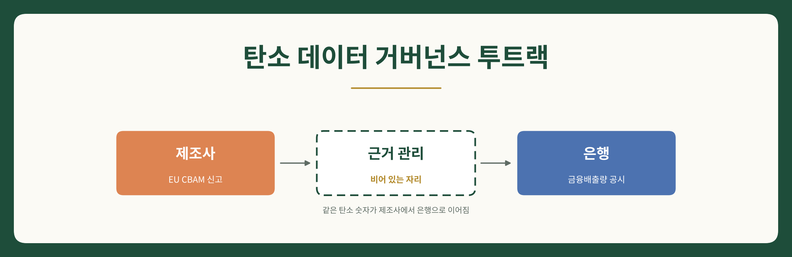

  
  
  

  📄 <a href="REPORT.md">상세 보고서</a> &nbsp;·&nbsp; 📁 <a href="docs/progress">진행 문서</a> &nbsp;·&nbsp; 📋 <a href="docs/decision_log.md">결정 기록</a> &nbsp;·&nbsp; 📈 <a href="figures">그림 모음</a>

## 목차

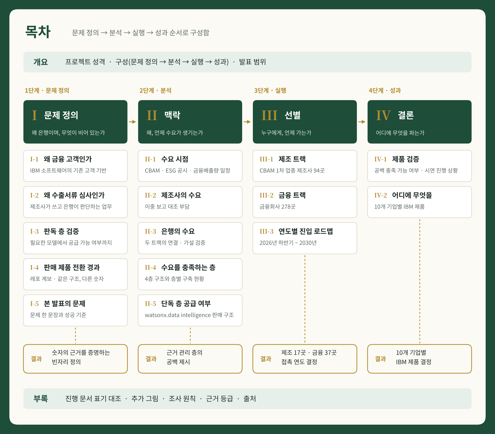

표 원문 보기

| 구분 | 번호 | 내용 |
|---|---|---|
| 개요 | — | 프로젝트 성격·구성·범위 |
| 🔑 Ⅰ 문제 정의 | Ⅰ-1 | 왜 금융 고객인가 — IBM 소프트웨어의 기존 고객 기반 |
| | Ⅰ-2 | 왜 은행의 수출서류 심사인가 — 제조사가 쓰고 은행이 판단하는 업무 |
| | Ⅰ-3 | 수출서류 판독 층 검증 — 필요한 모델에서 공급 가능 여부까지 |
| | Ⅰ-4 | 판매 제품의 전환 경과 — 판독 모델에서 탄소 데이터 거버넌스로 |
| | Ⅰ-5 | 본 발표의 문제와 성공 기준 |
| 🧭 Ⅱ 맥락 | Ⅱ-1 | 수요 시점 — 규제 일정 |
| | Ⅱ-2 | 제조사의 수요 — 이중 보고 대조 부담 |
| | Ⅱ-3 | 은행의 수요 — 두 트랙의 연결 |
| | Ⅱ-4 | 수요를 충족하는 층 — 탄소 데이터 4층 구조와 층별 구축 현황 |
| | Ⅱ-5 | 단독 층 공급 가능 여부 — watsonx.data intelligence의 판매 구조 |
| 🔍 Ⅲ 선별 | Ⅲ-1 | 제조 트랙 — CBAM 1차 업종 제조사 |
| | Ⅲ-2 | 금융 트랙 — 금융회사 |
| | Ⅲ-3 | 연도별 진입 로드맵 |
| 📌 Ⅳ 결론 | Ⅳ-1 | 제품 검증 — watsonx.data intelligence의 공백 충족 가능 여부·시연 진행 상황 |
| | Ⅳ-2 | 어디에 무엇을 — 10개 기업별 IBM 제품 |
| 부록 | — | 진행 문서 표기 대조·추가 그림·조사 원칙·출처 |

---

<b>개요 — 프로젝트 성격·구성·범위</b>

### 프로젝트 성격

- 통계 자료에서 새로운 인사이트를 발견·도출하는 탐색형 분석이 아님
- 확정된 규제 일정과 공개 자료를 기준으로, 최적의 접촉 시기와 규모를 갖춘 기업을 선별하는 작업임
- 진행 순서: 고객 과제를 숫자로 찾음 → 그 숫자로 누구부터 접촉할지 정함 → 기업별 데이터의 특수성에 맞는 IBM 제품을 연결함
- 따라서 판단의 무게는 데이터의 양이 아닌 선별 기준의 타당성과 근거의 추적 가능성에 있음

### 구성

- 문제 정의 → 분석 → 실행 → 성과 순서로 구성함
- Ⅰ 문제 정의: 은행을 최초 고객사로 선정한 근거와, 은행이 사용하는 숫자에서 비어 있는 부분
- Ⅱ 맥락(분석): 왜, 언제 수요가 생기는가
- Ⅲ 선별(실행): 누구에게, 언제 가는가
- Ⅳ 결론(성과): 어디에 무엇을 파는가

### 발표 범위

- 선행 프로젝트 결과
  - trade-doc-parsing-model-eval: 최초 고객사와 대상 업무의 선정 근거, 판독 모델 성능 비교 결과 — Ⅰ-2·Ⅰ-3
  - cbam-mfg-data-layer-entry: CBAM 품목 판정 결과, IT 투자 여력 기준(CBAM 1차 적용 중견 IT 투자 중앙값) — Ⅰ-4·Ⅲ-1
  - mfg-energy-entry-ladder(중단): 제조 중견 73곳 명단, 경쟁 대안 분석 방식 — Ⅰ-4·Ⅲ-1
- 진행 문서 00\~07(분석 단계): 대상 선별·채점·연도별 로드맵 — Ⅱ·Ⅲ부
- 진행 문서 08\~10(시연 단계, 2026-10-14 기준 진행 중): 시연 대상 기업 8곳의 공개 데이터와 시연 설계를 Ⅳ-1.2·Ⅳ-2에 사용함. 시연 결과(실제 형태 데이터 판정)는 포함하지 않음

## 🔑 Ⅰ 문제 정의 — 왜 은행이며, 무엇이 비어 있는가

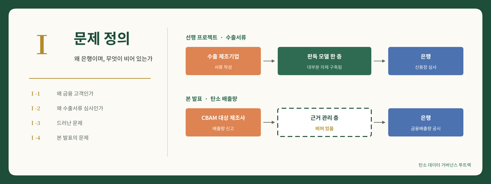

<b>Ⅰ-1. 왜 금융 고객인가 — IBM 소프트웨어의 기존 고객 기반</b>

### Ⅰ-1.1 판매 영역 — 소프트웨어

- IBM 2025년 매출 675.4억 달러 중 소프트웨어 부문이 299.6억 달러(44%)이며, 부문 이익 합계 163.6억 달러 중 99.2억 달러(61%)를 차지함
- 소프트웨어 매출은 전년 대비 10.6% 증가했으며 부문 이익률은 33.1%임 → 성장과 이익을 함께 주도하는 소프트웨어 부문을 판매 영역으로 정함

### Ⅰ-1.2 고객 — 금융권

- IBM 공식 자료: 세계 50대 은행 중 43곳, 10대 결제회사 중 8곳이 IBM 메인프레임을 핵심 플랫폼으로 사용함 (IBM Institute for Business Value 보고서 인용, 2026-09-03 갱신)
- 국내 거래: 국민은행 메인프레임 계약 2030년까지 갱신(2024-12) · 메리츠증권 핵심 거래 시스템 IBM 파워11 도입(2026-03) · 하나캐피탈 재해복구 스토리지(2024-04) · 롯데카드 파워10(2023-04)
- 본 레포 기록: 금융회사 278곳 중 IBM 거래 이력 점수 1점 이상 75곳 — 자체 계약 16곳(최근 5년 공개 계약 4곳 포함), 같은 보고 단위 계열사의 계약 59곳
- 금융회사는 민감 데이터의 외부 반출을 제한함 — 한국은 망분리·데이터 민감도·규제 승인 부담이 내재화 범위를 결정하며, 금융회사 80%(아시아태평양 87%)가 AI 공급사 선정 시 출신 국가를 고려함 (딜로이트, 2026-09) → 은행 내부에 설치하는 소프트웨어 수요가 존재함
- 선정 사유: 금융권은 IBM의 전통적 핵심 고객층이며, 기존 거래 관계를 진입 경로로 활용하기 위해 최초 고객사로 은행을 선정함

### Ⅰ-1.3 불리한 근거

- 국내 기존 관계는 인프라(메인프레임·서버·스토리지) 중심이며, 데이터·AI 공개 사례는 2022년 국민은행 개발 지원 1건이고 거버넌스 제품 계약은 없음
- 국내 시중은행 대부분이 메인프레임을 떠남

<b>Ⅰ-2. 왜 은행의 수출서류 심사인가 — 제조사가 쓰고 은행이 판단하는 업무</b>

### Ⅰ-2.1 업무 구조

- 신용장은 개설은행이 일치하는 서류 제시에 대해 대금 지급을 확약하는 약정이며, 개설은행은 신용장을 발행하는 은행으로 정의됨 (UCP 600 제2조) → 서류 심사의 주체는 은행임
- 수출 제조기업이 상업송장·포장명세서·선하증권을 작성해 제출하고, 은행이 신용장 조건과 대조해 심사함 → 하나의 문서를 사이에 두고 제조업과 금융업이 연결됨
- 구매자는 은행이며, 서류 작성자는 수출 제조기업임
- 판독 모델은 문서 전반에 적용되는 범용 모델이며, 수출서류 심사는 판정 규칙이 국제 규칙으로 명문화되어 성능을 검증할 수 있는 최초 적용 업무로 선정함

### Ⅰ-2.2 은행 심사의 부담

- 신용장 서류의 1차 제출 거절률은 세계 기준 65\~80%로 추정됨 (ICC 은행위원회 기술 자문 브리핑 3호, 2022-06 — 추정치이며 최종 지급 거절률이 아닌 1차 제출 기준)
- 은행은 서류 일치 여부 판단에 제출 다음 날부터 최대 5영업일을 사용함 (UCP 600 제14조 b) → 거절 시 수출 제조기업은 서류를 다시 작성해 제출하며, 재심사에 다시 최대 5영업일이 소요됨
- 일치 여부의 판정 규칙이 UCP 600과 국제표준은행관행으로 명문화되어 있어, 판독 모델의 출력을 평가할 기준이 외부에 존재함

### Ⅰ-2.3 은행 내부 설치 요구

- 출처: 딜로이트 「아시아태평양 금융서비스 산업의 미래」(2026-09)
  - 공급망 재편으로 무역금융·거래은행 수요가 증가함 (13쪽). 한국에도 무역금융 수요가 존재함 (18쪽)
  - 선택적 내재화: 판단 규칙·판단근거 기록은 은행이 보유하고 범용 모델은 외부에서 도입함. 한국은 망분리·데이터 민감도·규제 승인 부담이 내재화 범위를 결정함 (36쪽)
  - 기술주권: 금융회사 80%(아시아태평양 87%)가 AI 공급사 선정 시 출신 국가를 고려함. 보고서는 완전한 독립이 아닌 신뢰할 수 있는 파트너십을 권고함 (39쪽)
  - 실제 사례: KB국민은행의 법인 고객 확인 서류 AI 판독 (42쪽)

### Ⅰ-2.4 최초 고객사 및 대상 업무의 선정 경로 (Ⅰ-1·Ⅰ-2 요약)

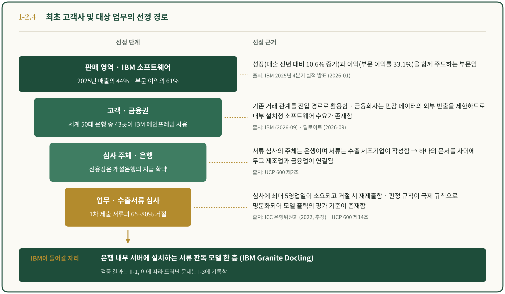

판매 영역(소프트웨어)에서 고객(금융권)·심사 주체(은행)·대상 업무(수출서류 심사) 순으로 범위를 좁혀 IBM이 진입할 한 층을 선정함

<b>Ⅰ-3. 수출서류 판독 층 검증 — 필요한 모델에서 공급 가능 여부까지</b>

### Ⅰ-3.1 수요를 충족하는 모델 — 선행 프로젝트(trade-doc-parsing-model-eval) 결과

- 은행 내부 서버에 설치 가능한 판독 모델 2종(IBM Granite Docling 258M · PaddleOCR-VL 0.9B)의 상업송장 150장 금액·날짜·상호 추출 정확도가 동일함
- 도입 여부는 모델 성능이 아닌 운영비와 재제출 비용의 비율이 결정함

### Ⅰ-3.2 고객사의 현재 구축 단계 — 국내 대형·중견 금융사의 판독 AI 자체 구축 현황

**조사 대상과 규모 구분**

- 대상: 신용장·수출환어음 업무를 취급하는 국내 은행 17곳과 인터넷은행 3곳, 비은행 대형 금융사 26곳
- 대형 은행: 금융위원회 지정 시스템적 중요 은행 5곳(국민·신한·하나·우리·농협, 2027년도 지정)과 지정 기준을 넘었으나 국책은행이라 제외된 2곳(산업·기업)
- 중견 은행: 그 외 시중·특수·지방은행 10곳
- 확인 방법: 회사 공식 발표·주요 언론·감독기관 자료로 확인함. 공개 자료가 없는 경우는 '공개 자료 없음'으로 표시하며, 미도입을 의미하지 않음

**은행 — 무역·외환 서류 판독 AI**

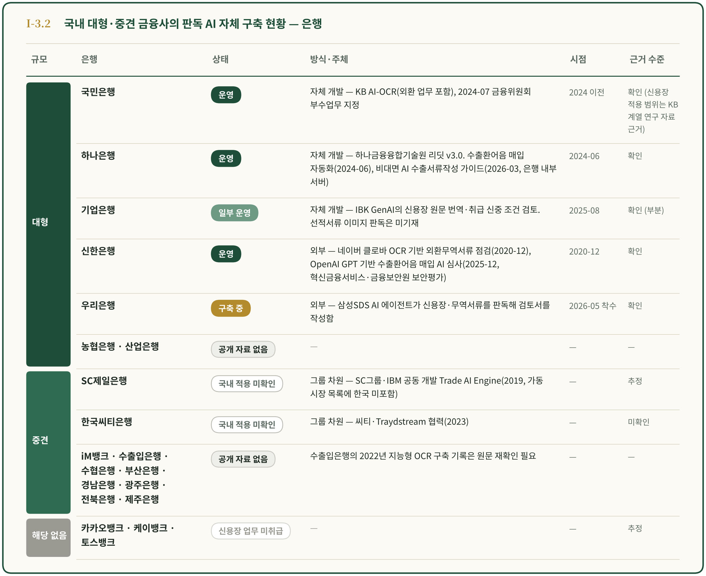

표 원문 보기

| 규모 | 은행 | 상태 | 방식·주체 | 시점 | 근거 수준 |
|---|---|---|---|---|---|
| 대형 | 국민은행 | 운영 | 자체 개발 — KB AI-OCR(외환 업무 포함), 2024-07 금융위원회 부수업무 지정 | 2024 이전 | 확인 (신용장 적용 범위는 KB 계열 연구 자료 근거) |
| 대형 | 하나은행 | 운영 | 자체 개발 — 하나금융융합기술원 리딧 v3.0. 수출환어음 매입 자동화(2024-06), 비대면 AI 수출서류작성 가이드(2026-03, 은행 내부 서버) | 2024-06 | 확인 |
| 대형 | 기업은행 | 일부 운영 | 자체 개발 — IBK GenAI의 신용장 원문 번역·취급 신중 조건 검토. 선적서류 이미지 판독은 미기재 | 2025-08 | 확인 (부분) |
| 대형 | 신한은행 | 운영 | 외부 — 네이버 클로바 OCR 기반 외환무역서류 점검(2020-12), OpenAI GPT 기반 수출환어음 매입 AI 심사(2025-12, 혁신금융서비스·금융보안원 보안평가) | 2020-12 | 확인 |
| 대형 | 우리은행 | 구축 중 | 외부 — 삼성SDS AI 에이전트가 신용장·무역서류를 판독해 검토서를 작성함 | 2026-05 착수 | 확인 |
| 대형 | 농협은행 · 산업은행 | 공개 자료 없음 | — | — | — |
| 중견 | SC제일은행 | 국내 적용 미확인 | 그룹 차원 — SC그룹·IBM 공동 개발 Trade AI Engine(2019, 가동 시장 목록에 한국 미포함) | — | 추정 |
| 중견 | 한국씨티은행 | 국내 적용 미확인 | 그룹 차원 — 씨티·Traydstream 협력(2023) | — | 미확인 |
| 중견 | iM뱅크 · 수출입은행 · 수협은행 · 부산은행 · 경남은행 · 광주은행 · 전북은행 · 제주은행 | 공개 자료 없음 | 수출입은행의 2022년 지능형 OCR 구축 기록은 원문 재확인 필요 | — | — |
| 해당 없음 | 카카오뱅크 · 케이뱅크 · 토스뱅크 | 신용장 업무 미취급 | — | — | 추정 |

**비은행 대형 금융사 26곳 — 문서 판독 AI(보험금 청구 서류·계약 서류 등)**

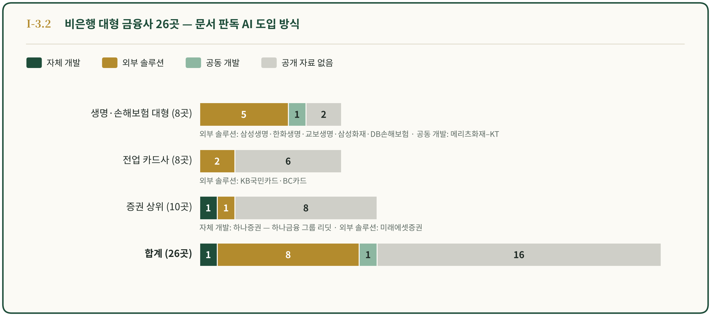

표 원문 보기

| 금융 업종 | 대상 | 자체 개발 | 외부 솔루션 | 공동 개발 | 공개 자료 없음 |
|---|---|---|---|---|---|
| 생명·손해보험 대형 | 8곳 | 0곳 | 5곳 (삼성생명·한화생명·교보생명·삼성화재·DB손해보험) | 1곳 (메리츠화재–KT) | 2곳 |
| 전업 카드사 | 8곳 | 0곳 | 2곳 (KB국민카드·BC카드) | 0곳 | 6곳 |
| 증권 상위 | 10곳 | 1곳 (하나증권 — 하나금융 그룹 리딧) | 1곳 (미래에셋증권) | 0곳 | 8곳 |
| 합계 | 26곳 | 1곳 | 8곳 | 1곳 | 16곳 |

- 외부 솔루션 업체: 로민, 업스테이지, 네이버클라우드, KT 등 국내 사업자
- 삼성화재·DB손해보험·KB국민카드의 외부 솔루션 사용은 공급 업체 측 발표 기준임

**참고 통계**

- 국내 금융권의 AI 자체 개발·외부 조달 비율에 대한 공식 통계는 확인되지 않음 — 금융감독원 전수조사(2025-04, 118개사, AI 서비스 653개)는 구분 수치를 공개하지 않음
- 핀테크산업협회 포럼 발표(2026-06-23): AI 도입 금융사 중 자체 모델 개발 10% — 표본·조사 주체 비공개로 참고 수치에 해당함
- 국내 금융회사 IT 인력의 51.7%가 외부 인력임 (한국은행 금융정보화추진협의회, 2023년 말, 145개사)
- 글로벌 금융업계의 63%가 외부 기반 모델 위에 내부 업무 흐름을 구성함 (케임브리지 대안금융센터, 2026, 628개 기관)

**해석**

- 판독 AI 자체 개발은 그룹 IT 조직을 보유한 일부 대형 금융그룹(하나·KB)과 국책은행(기업은행)에 한정됨
- 대형 은행 7곳 중 5곳은 판독 AI를 운영하거나 구축 중임 → 선행 프로젝트가 범위 밖으로 둔 '솔루션 교체' 영역에 해당함
- 진입 여지는 국내 도입 공개 사례가 없는 중견 은행 10곳과 공개 자료가 없는 대형 은행 2곳(농협·산업)에 남음
- 공개 자료 부재는 미도입을 의미하지 않으므로, 진입 여지는 좁고 공개 자료만으로 즉시 식별되지 않음 → 공개 자료와 규제 일정으로 대상과 시점을 체계적으로 선별하는 방법이 필요함

**불리한 근거**

- 신한은행은 외부 상용 모델(OpenAI GPT)을 혁신금융서비스 지정과 금융보안원 보안평가를 거쳐 수출서류 심사에 적용함 → 은행 내부 배포 전제와 다른 사례임
- 우리은행은 국내 SI(삼성SDS)를, 지방은행은 국내 클라우드 사업자(네이버클라우드·KT)를 선택하는 흐름임 → 모델 층 공급은 SI 경유 가능성이 큼
- KB AI-OCR은 부수업무 지정으로 외부 판매가 가능하며 하나금융 리딧은 그룹 외부(포스코인터내셔널)에 판매됨 → 금융그룹 IT 조직도 공급자로 경쟁함
- 비은행 대형 보험사 다수는 국내 문서 AI 업체 솔루션을 운영 중임 → 자체 미구축 금융사 상당수는 빈 시장이 아닌 교체·고도화 시장임
- IBM은 SC그룹과 무역서류 AI를 공동 개발한 이력(2019)이 있으나, 모델 한 층이 아닌 공동 완성 솔루션 형태였음

### Ⅰ-3.3 IBM이 공급할 단독 층 — 판독 모델 한 층

- 판단 규칙과 판정 기록은 은행이 보유하고, IBM은 은행 내부 시스템의 판독 모델 한 층만 공급함
- 판독 AI 구축을 마친 은행은 선행 프로젝트의 범위 밖인 솔루션 교체 영역이며, 진입 대상은 판독 AI를 구축하지 않은 은행이 내부에 만드는 시스템의 모델 층임

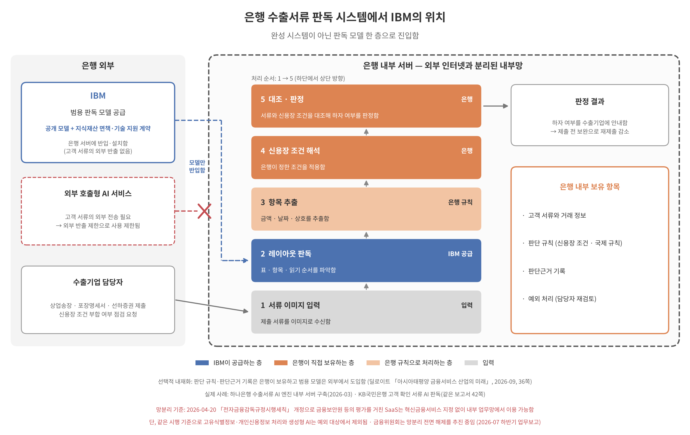

완성 시스템이 아닌 판독 모델 한 층(2번)만 IBM이 공급하며, 판단 규칙과 기록은 은행이 보유함

### Ⅰ-3.4 단독 층 공급 가능 여부 — IBM 판매 정책

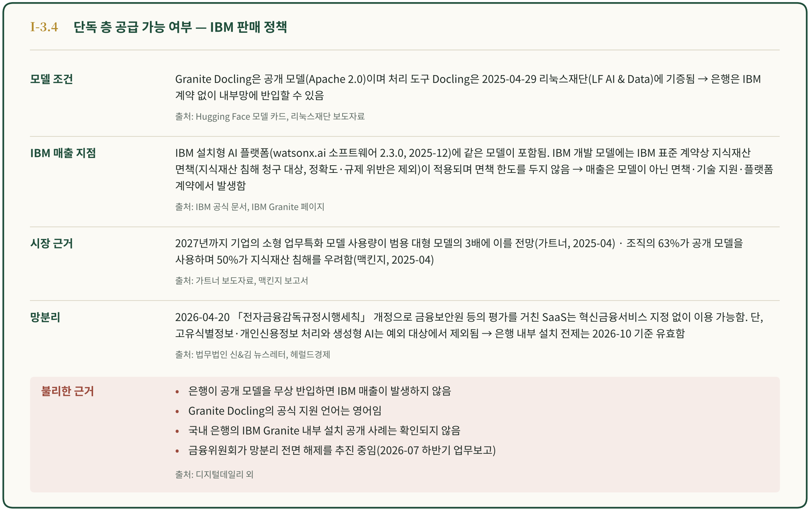

표 원문 보기

| 구분 | 내용 | 출처 |
|---|---|---|
| 모델 조건 | Granite Docling은 공개 모델(Apache 2.0)이며 처리 도구 Docling은 2025-04-29 리눅스재단(LF AI & Data)에 기증됨 → 은행은 IBM 계약 없이 내부망에 반입할 수 있음 | Hugging Face 모델 카드, 리눅스재단 보도자료 |
| IBM 매출 지점 | IBM 설치형 AI 플랫폼(watsonx.ai 소프트웨어 2.3.0, 2025-12)에 같은 모델이 포함됨. IBM 개발 모델에는 IBM 표준 계약상 지식재산 면책(지식재산 침해 청구 대상, 정확도·규제 위반은 제외)이 적용되며 면책 한도를 두지 않음 → 매출은 모델이 아닌 면책·기술 지원·플랫폼 계약에서 발생함 | IBM 공식 문서, IBM Granite 페이지 |
| 시장 근거 | 2027년까지 기업의 소형 업무특화 모델 사용량이 범용 대형 모델의 3배에 이를 전망(가트너, 2025-04) · 조직의 63%가 공개 모델을 사용하며 50%가 지식재산 침해를 우려함(맥킨지, 2025-04) | 가트너 보도자료, 맥킨지 보고서 |
| 망분리 | 2026-04-20 「전자금융감독규정시행세칙」 개정으로 금융보안원 등의 평가를 거친 SaaS는 혁신금융서비스 지정 없이 이용 가능함. 단, 고유식별정보·개인신용정보 처리와 생성형 AI는 예외 대상에서 제외됨 → 은행 내부 설치 전제는 2026-10 기준 유효함 | 법무법인 신&김 뉴스레터, 헤럴드경제 |
| 불리한 근거 | 은행이 공개 모델을 무상 반입하면 IBM 매출이 발생하지 않음 · Granite Docling의 공식 지원 언어는 영어임 · 국내 은행의 IBM Granite 내부 설치 공개 사례는 확인되지 않음 · 금융위원회가 망분리 전면 해제를 추진 중임(2026-07 하반기 업무보고) | 디지털데일리 외 |

### Ⅰ-3.5 결과와 남은 질문

- 결론: IBM은 완성 시스템이 아닌 판독 모델 한 층으로 진입하며, 매출은 그 층에 붙는 면책·기술 지원·플랫폼 계약에서 발생함
- 드러난 문제: 대형 은행 7곳 중 5곳은 판독 AI를 운영하거나 구축 중임. 진입 여지는 중견 은행 10곳과 공개 자료가 없는 대형 은행 2곳에 남으나, 공개 자료만으로 즉시 식별되지 않음
- 남은 질문: 판독 AI를 자체 구축하지 않은 금융사를 공개 자료로 어떻게 찾고, 어느 시점에 접근하는가 — 선행 프로젝트는 '무엇을 제안하는가'를 정했으나 '누구에게·언제'는 다루지 않음

<b>Ⅰ-4. 판매 제품의 전환 경과 — 판독 모델에서 탄소 데이터 거버넌스로</b>

### Ⅰ-4.1 레포 계보

표 원문 보기

| 순서 | 레포·기록 | 다룬 질문 | 결론 | 다음 단계에 남긴 것 |
|---|---|---|---|---|
| 1 | trade-doc-parsing-model-eval | 은행 서류 판독 모델 중 어느 모델을 권할 것인가 | 모델 성능은 동일하며, 도입 여부는 운영비 대비 재제출 비용이 결정함 | 모델 한 층 진입 원칙, 판정 기준 사전 확정 방식 |
| 2 | cbam-mfg-data-layer-entry | CBAM 대응이 가장 이른 중견 제조사는 어디이며 데이터 층 도입 부담은 어느 정도인가 | 상장 중견 645곳 중 2028년까지 대응 필요 94\~189곳. 대응이 급한 기업일수록 IT 예산이 작음(CBAM 1차 적용 중견 IT 투자 중앙값 14.3억 원, 비대상 33.3억 원) | IT 투자 여력 기준, CBAM 품목 판정 결과 |
| 3 | mfg-energy-entry-ladder (중단) | 전기요금 절감을 무료 입구로 삼아 유료 단계까지 확대할 수 있는가 | 정부 무상 에너지관리시스템 사업·한국전력 무료 서비스와 중복되어 입구가 성립하지 않음 (2026-09-29 중단) | 경쟁 대안 분석 방식, 제조 73곳 명단 |
| 4 | 결정 기록 — 기각 후보군 20건 | 어느 고객군과 진입 층이 남아 있는가 | 기각 사유 반복 — 이미 채워진 자리, 정부·공공 흡수, 예산 부족, 동기 약함 | 판정 기준의 근거 |
| 5 | carbon-data-governance-two-track (본 레포) | 공개 자료만으로 누구에게, 언제 진입할지 정할 수 있는가 | 제조 17곳·금융 37곳의 우선 계정과 접촉 시기를 결정함 | — |

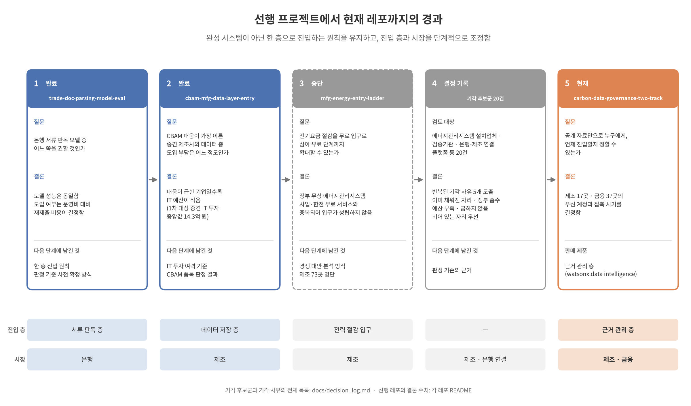

판매 제품과 시장은 바뀌었으나, 비어 있는 한 층으로 진입하는 원칙은 유지됨

- IBM의 제조업 관심: 2026년 한국IBM의 제조 대상 행사 3회로 확인됨 (3월 5일 CIO코리아 조찬 · 5월 19일 데이터 리더십 행사 · 6월 16일 산업AX KOREA 'AI Ready Data' — 거버넌스·카탈로그·품질·계보)

### Ⅰ-4.2 도출 원칙

- 이미 채워진 자리(금융사 자체 구축·정부 무상 사업·기존 벤더)는 피함
- 공개 자료 범위에서 아직 비어 있는 층과 고객만 노림
- 이어지는 것은 제품이 아닌 방법과 원칙임 — 판매 제품은 판독 모델에서 탄소 데이터 거버넌스로 바뀌었으며, '공개 자료와 규제 일정으로 대상·시점을 선별하는 방법'과 '비어 있는 곳을 노리는 원칙'이 이어짐

### Ⅰ-4.3 같은 구조, 다른 숫자

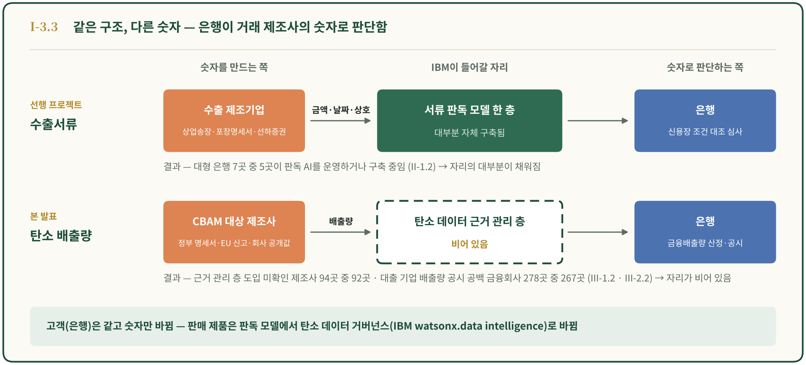

은행이 거래 제조사의 숫자로 판단하는 구조는 같으며, 판독 모델 층은 대부분 채워졌으나 탄소 데이터 근거 관리 층은 비어 있음

- 수출서류: 수출 제조기업이 작성한 서류의 금액·날짜·상호로 은행이 신용장 심사를 함
- CBAM(Carbon Border Adjustment Mechanism, EU 탄소국경조정제도): EU로 수입되는 철강·알루미늄·시멘트·비료·수소·전력의 생산 과정 배출량(내재 배출량)만큼 EU 수입자가 EU 배출권 가격에 연동된 인증서를 구매하게 하는 제도임. 탄소 규제가 약한 국가의 제품이 EU 역내 제품보다 가격 우위를 갖지 않도록 하는 장치이며, 수출 제조사가 제품별 실측 배출량을 제공하지 않으면 할증이 붙은 기본값이 적용됨 (일정은 Ⅱ-1.1)
- 탄소 배출량: CBAM 대상 제조사가 신고한 배출량이 은행 금융배출량 산정의 입력값이 됨 (Ⅱ-3.1)
- 고객(은행)은 같고 숫자만 바뀜 → 판매 제품이 판독 모델에서 탄소 데이터 거버넌스(IBM watsonx.data intelligence)로 바뀜

<b>Ⅰ-5. 본 발표의 문제와 성공 기준</b>

### Ⅰ-5.1 문제

> 은행은 거래 제조사가 낸 숫자로 심사하고 공시하지만, 그 숫자가 어디서 왔는지 증명하는 일은 비어 있음. 이 빈자리를 채우는 IBM 제품을 누구에게 언제 팔지 정함

### Ⅰ-5.2 답하는 질문

- 누구에게: 탄소 데이터 거버넌스 제품(IBM watsonx.data intelligence)을 어떤 규모의 어느 제조사·금융회사에 제안하는가 → Ⅲ-1·Ⅲ-2
- 언제: 각 기업에 어느 연도에 접촉하는가 → Ⅲ-3
- 무엇을: 각 기업의 데이터와 특수성에 맞춰 IBM 제품 중 무엇을 제안하는가 → Ⅳ-2

### Ⅰ-5.3 성공 기준

- 공백 확인: 제조사 94곳·금융회사 278곳 전체에 근거 관리 층 공백 가설을 적용해 채택·기각을 판정함 (Ⅲ-1.3·Ⅲ-2.3)
- 대상·시점 결정: 결과 확인 전에 확정한 채점 기준으로 우선 계정과 접촉 연도를 정함 (Ⅲ-1·Ⅲ-2·Ⅲ-3)
- 제품 결정: 기업별 데이터 특수성에 맞는 IBM 제품을 정하고, 불리한 근거와 결론에 붙는 조건을 함께 기록함 (Ⅳ-2)
- 추적 가능성: 모든 명단·숫자를 진행 문서와 데이터 파일로 추적할 수 있음

### Ⅰ-5.4 범위의 한계

- 공개 자료 범위의 판정이며, 기업 내부 자료로 검증하지 않음
- 시연 결과(실제 형태 데이터 판정)는 포함하지 않음 (Ⅳ-1.2)

---

## 🧭 Ⅱ 맥락 — 왜, 언제 수요가 생기는가

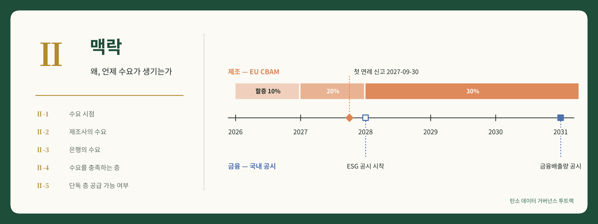

<b>Ⅱ-1. 수요 시점 — 규제 일정</b>

### Ⅱ-1.1 제조 — EU 탄소국경조정제도(CBAM)

- 2026-01-01 확정 기간 개시 → 2027-02-01 인증서 판매 시작 → 2027-09-30 첫 연례 신고·인증서 반납
- 실측 배출량 미제출 시 기본값에 할증이 적용되며, 할증률은 2026년 10% → 2027년 20% → 2028년 30%로 확대됨
- 하류 품목 확대: 2028-01-01 적용 목표이나 EU 3자 협상 중임 (1차 정치 협상 2026-10-20, 2차 2026-11-30 잠정, 연내 합의 목표) — 미정
  - 3자 협상: EU 법안의 최종 문구를 EU 집행위원회(법안 제안 기관)·EU 이사회(27개 회원국 정부 대표)·유럽의회(EU 시민이 직접 선출한 의원)가 함께 합의하는 협상임. 세 기관이 제시한 대상 품목 수가 서로 달라(약 180개\~457개) 합의 전까지 범위가 확정되지 않음

### Ⅱ-1.2 금융 — 지속가능성(ESG) 공시 법제화와 금융배출량 공시

- 정부 최종안(금융위원회, 2026-07-08): 2028년 연결자산 10조 원 이상 코스피 상장사부터 사업보고서 법정 공시 시작 → 2030년 제3자 인증 시작 → 2031년 금융배출량(대출·투자 대상 기업의 배출량) 공시 시작
- 자본시장법 개정안은 국회 계류 중이며, 금융배출량 공시는 2026-10 기준 자율임

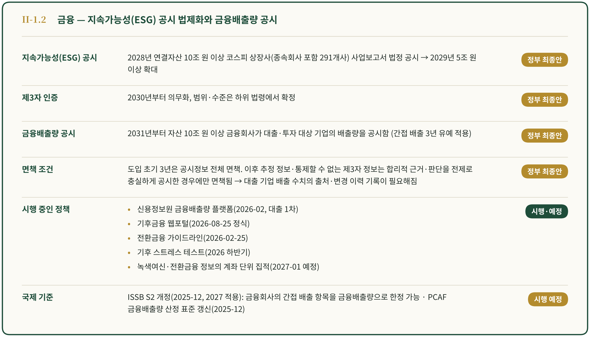

표 원문 보기

| 구분 | 내용 | 상태 |
|---|---|---|
| 지속가능성(ESG) 공시 | 2028년 연결자산 10조 원 이상 코스피 상장사(종속회사 포함 291개사) 사업보고서 법정 공시 → 2029년 5조 원 이상 확대 | 정부 최종안 (2026-07-08), 자본시장법 개정안 국회 계류 |
| 제3자 인증 | 2030년부터 의무화, 범위·수준은 하위 법령에서 확정 | 정부 최종안 |
| 금융배출량 공시 | 2031년부터 자산 10조 원 이상 금융회사가 대출·투자 대상 기업의 배출량을 공시함 (간접 배출 3년 유예 적용) | 정부 최종안, 2026-10 기준 자율 공시 단계 |
| 면책 조건 | 도입 초기 3년은 공시정보 전체 면책. 이후 추정 정보·통제할 수 없는 제3자 정보는 합리적 근거·판단을 전제로 충실하게 공시한 경우에만 면책됨 → 대출 기업 배출 수치의 출처·변경 이력 기록이 필요해짐 | 정부 최종안 |
| 시행 중인 정책 | 신용정보원 금융배출량 플랫폼(2026-02, 대출 1차) · 기후금융 웹포털(2026-08-25 정식) · 전환금융 가이드라인(2026-02-25) · 기후 스트레스 테스트(2026 하반기) · 녹색여신·전환금융 정보의 계좌 단위 집적(2027-01 예정) | 시행·예정 |
| 국제 기준 | ISSB S2 개정(2025-12, 2027 적용): 금융회사의 간접 배출 항목을 금융배출량으로 한정 가능 · PCAF 금융배출량 산정 표준 갱신(2025-12) | 시행 예정 |

### Ⅱ-1.3 공급망 탄소 관리 확산

- 출처: 딜로이트 「공급망 저탄소 전환」(2026-09)
  - 공급망 탄소를 관리하는 코스피 기업 비율이 14.6%에서 24.8%로 증가함 (3쪽)
  - 공급망 탄소 관리에 신뢰할 수 있는 증빙 데이터가 필요하다고 제언함 (11쪽)

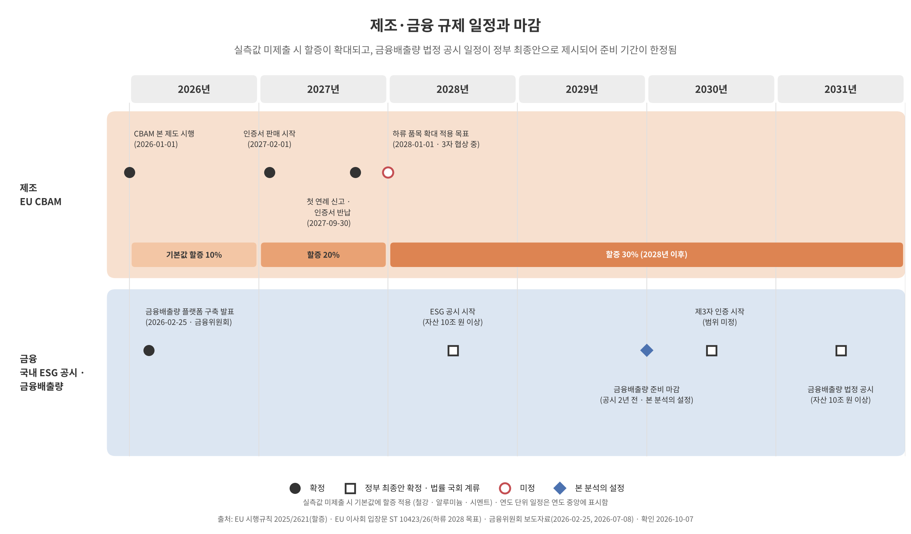

제조사는 2027-09-30 첫 연례 신고, 금융회사는 2031년 금융배출량 공시가 마감임

<b>Ⅱ-2. 제조사의 수요 — 이중 보고 대조 부담</b>

### Ⅱ-2.1 정부 보고와 EU 보고의 단위 차이

- 정부 보고는 CBAM과 별개인 국내법 의무임 (배출권거래제·목표관리제)
- 정부에 제출하는 배출량: 사업장 단위 총량이며 제3자 검증을 받음 (배출권거래제 할당대상업체 명세서·온실가스 목표관리업체 명세서)
- EU CBAM에 제출하는 배출량: 제품 1톤당 내재 배출량임
- 두 수치가 같은 원천 데이터에서 산출되었음을 대조·증명해야 하므로 출처와 배분 근거를 관리할 수요가 발생함

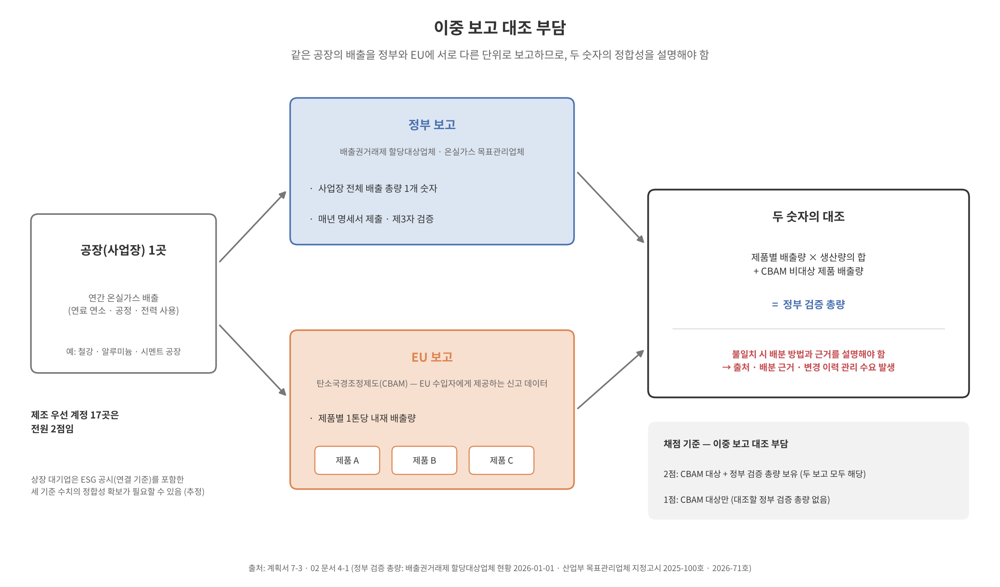

같은 공장의 배출을 정부(총량)와 EU(제품 1톤당)에 다른 단위로 보고하므로 두 숫자의 대조 근거가 필요함

<b>Ⅱ-3. 은행의 수요 — 두 트랙의 연결</b>

### Ⅱ-3.1 현황 — 제조사 배출량의 금융배출량 입력

- 금융배출량 = 대출 비율(대출 잔액 ÷ 대출 기업 가치) × 대출 기업 배출량 (PCAF 산식)
  - PCAF(Partnership for Carbon Accounting Financials, 탄소회계금융협의체): 금융회사가 대출·투자한 기업의 배출량 중 자기 몫을 계산하는 국제 표준(금융배출량 산정 표준)을 만드는 금융권 국제 협의체임. 사용한 배출 데이터의 품질을 1등급(검증된 실측)\~5등급(업종 평균 추정)으로 나눔
- 따라서 제조사의 사업장 배출량은 그 제조사에 대출한 금융회사의 금융배출량 입력값이 됨
- CBAM 대상 제조사 94곳 중 76곳이 금융회사 18곳과 직접 대출 거래를 하며, 산업은행 1곳이 58곳과 거래함

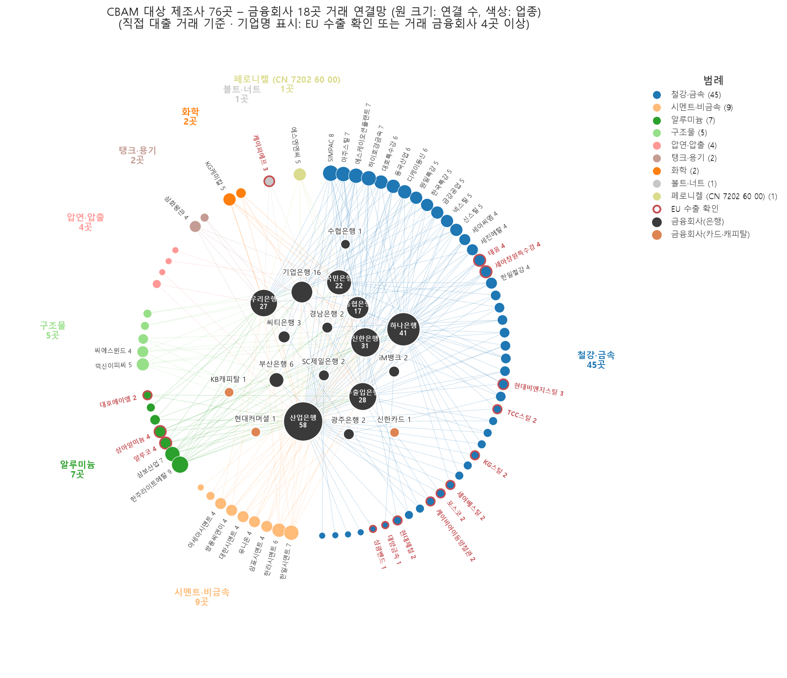

### Ⅱ-3.2 현황 — 제조사와 은행 사이의 탄소 데이터 요구 경로

- 요구 경로 8개: 시행 3 · 예정·정부 최종안 3 · 검토·미정 2
- 제조사는 같은 탄소 데이터를 EU 수입자(CBAM 신고)·정부(배출량 명세서)·ESG 공시·원청 고객사·은행(대출 심사) 5곳에 제출함
- 판매 우선순위 상위 제조사 35곳(Ⅲ-1 채점 결과 94곳 중 상위 37%) 중 32곳(91%)이 정책금융기관 3곳(산업은행·수출입은행·기업은행)과 거래함

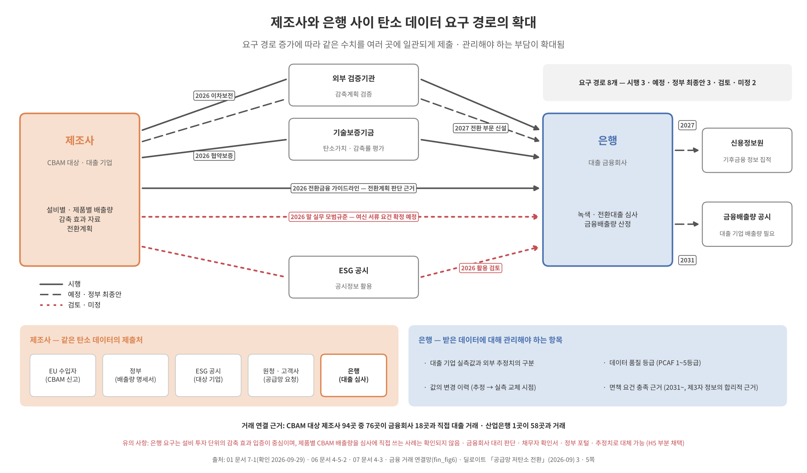

제조사의 탄소 숫자는 은행 금융배출량의 입력값이 되며, 요구 경로는 8개로 확대됨

### Ⅱ-3.3 가설 검증 — 은행의 검증 가능한 배출 데이터 요구

**① 가설과 판정 기준 (검증 전 확정)**

- 가설: 은행의 녹색·전환금융 심사와 금융배출량 산정은 대출 기업(제조사)에게 검증 가능한 배출 데이터를 요구하거나 우대함
- 판정 기준
  - 채택: 감독 당국 지침 또는 은행 2곳 이상에서 요구·우대가 확인됨
  - 부분 채택: 요구는 존재하나 다른 수단으로 대체할 수 있음
  - 기각: 요구·우대 사례 없음

**② 검증**

- 녹색여신 관리지침 제11조 (금융위원회·환경부·금융감독원, 2024-12)
  - 녹색여신: 정부의 녹색분류체계(K-택소노미)가 친환경으로 인정한 활동(재생에너지 발전·저탄소 설비 전환 등)에 쓰이는 대출임
  - 지침: 은행이 어떤 대출을 녹색여신으로 분류할지 판단하는 기준이며 은행이 자율로 적용함
  - 제11조: 은행은 대출 기업으로부터 녹색 활동에 해당한다는 근거자료를 받아야 함 → 요구 존재
  - 단서: 같은 지침이 적합성 판단은 은행이 대신하고, 환경 피해 배제·사회적 보호 기준은 대출 기업 확인서로 갈음하는 것을 허용함 → 대체 가능
- 전환금융 가이드라인 (2026-02): 대출 기업에게 서약서·전환전략 실행계획 제출을 요구함 → 요구 존재
  - 전환금융: 철강·시멘트처럼 탄소 배출이 많은 기업이 저탄소 공정으로 바꾸는 데 쓰이는 대출·투자임
- 감축 효과별 우대금리 차등: 정부가 추진 중이며 시행 전임 → 우대 미확정
- 은행 상품의 우대 조건: 온실가스 감축량을 금리 조건(성과 지표)으로 쓰는 대출 상품은 기업은행 1곳만 확인됨 → 은행 2곳 이상 기준 미충족

**③ 판정 — 부분 채택**

- 요구는 감독 지침과 가이드라인으로 존재하나 지침이 은행의 대리 판단·확인서 대체를 허용하고, 우대 조건은 은행 1곳과 시행 전 제도에 그치므로 부분 채택으로 판정함
- 결론 반영: 제안 문구를 은행 한 곳에 걸지 않고 "한 번 만든 탄소 데이터를 CBAM 신고·ESG 공시·은행 전환금융 심사에 함께 제출하는 체계"로 정함
- 재판정 조건: 전환금융 실무 모범규준 최종안이 대출 기업 배출 자료의 제출·검증을 의무로 규정하면 채택으로 전환함

<b>Ⅱ-4. 수요를 충족하는 층 — 탄소 데이터 4층 구조와 층별 구축 현황</b>

### Ⅱ-4.1 4층 구조와 판매 대상

표 원문 보기

| 층 | 기능 | 기존 공급자 | 판매 여부 |
|---|---|---|---|
| 수집 | 공장·ERP·고지서·외부 데이터 수집 | 제조: 설비 데이터 시스템·SI·무료 도구 / 금융: 신용정보원 금융배출량 플랫폼 | 판매 대상 아님 (경쟁 다수) |
| **근거 관리** | **실측·추정·검증 구분, 출처·변경 이력·판단 근거 기록** | **공개 자료 범위에서 탄소 전용 공급자 미확인** | **판매 대상 — IBM watsonx.data intelligence (계보·품질·카탈로그)** |
| 산정 | CBAM 배출량·금융배출량 산정 | 신용정보원 플랫폼, 국내 탄소 산정 앱, SI | 판매 대상 아님 |
| 활용 | 대시보드·감축 시나리오 | 고객 자체 | 판매 대상 아님 |

- 제품 정의: 여러 출처에서 들어온 탄소 수치를 회사 내부에서 출처·변경 이력·판단 근거와 함께 관리하는 층
- 두 트랙에 같은 제품을 제안하는 사유: 두 트랙 모두 여러 출처의 탄소 수치를 외부 검증에 제출해야 하며, 수치 자체보다 수치의 근거를 증명해야 함
- IBM Envizi와의 구분: Envizi는 배출량 산정·공시 보고 제품으로 산정 층에 해당하며, 판매 대상인 근거 관리 층과 구분됨

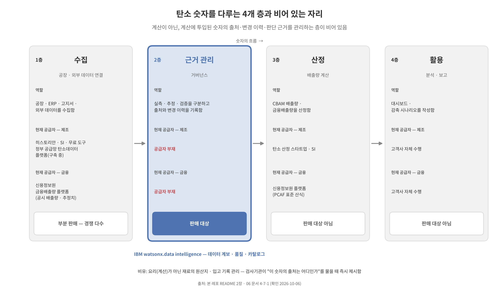

계산이 아닌, 계산에 투입된 숫자의 출처를 증명하는 근거 관리 층에 공급자가 없음

<b>Ⅱ-5. 단독 층 공급 가능 여부 — watsonx.data intelligence의 판매 구조</b>

### Ⅱ-5.1 단독 판매·요금·구매 경로

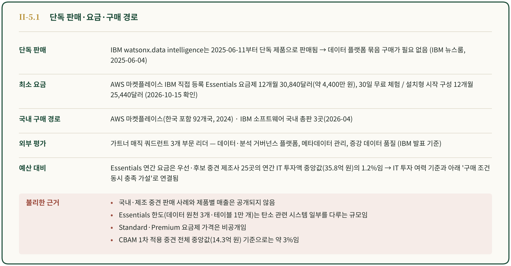

표 원문 보기

| 구분 | 내용 |
|---|---|
| 단독 판매 | IBM watsonx.data intelligence는 2025-06-11부터 단독 제품으로 판매됨 → 데이터 플랫폼 묶음 구매가 필요 없음 (IBM 뉴스룸, 2025-06-04) |
| 최소 요금 | AWS 마켓플레이스 IBM 직접 등록 Essentials 요금제 12개월 30,840달러(약 4,400만 원), 30일 무료 체험 / 설치형 시작 구성 12개월 25,440달러 (2026-10-15 확인) |
| 국내 구매 경로 | AWS 마켓플레이스(한국 포함 92개국, 2024) · IBM 소프트웨어 국내 총판 3곳(2026-04) |
| 외부 평가 | 가트너 매직 쿼드런트 3개 부문 리더 — 데이터·분석 거버넌스 플랫폼, 메타데이터 관리, 증강 데이터 품질 (IBM 발표 기준) |
| 예산 대비 | Essentials 연간 요금은 우선·후보 중견 제조사 25곳의 연간 IT 투자액 중앙값(35.8억 원)의 1.2%임 → IT 투자 여력 기준과 아래 '구매 조건 동시 충족 가설'로 연결됨 |
| 불리한 근거 | 국내·제조 중견 판매 사례와 제품별 매출은 공개되지 않음 · Essentials 한도(데이터 원천 3개·테이블 1만 개)는 탄소 관련 시스템 일부를 다루는 규모임 · Standard·Premium 요금제 가격은 비공개임 · CBAM 1차 적용 중견 전체 중앙값(14.3억 원) 기준으로는 약 3%임 |

### Ⅱ-5.2 판매 관건

- 판매 관건은 가격 부담이 아닌 'IT 예산 1\~3%를 탄소 데이터 근거 관리에 배정할 사유'의 입증임

---

## 🔍 Ⅲ 선별 — 누구에게, 언제 가는가

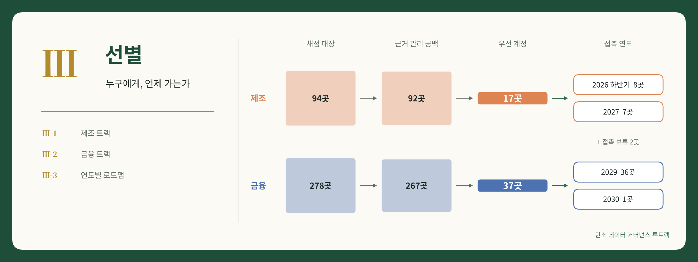

- Ⅱ부는 '탄소 데이터 근거 관리 층이 비어 있다'는 판단을 맥락과 공개 자료로 제시함
- Ⅲ부는 대상을 확정하고 채점 기준을 정한 뒤, 그 기준으로 제조사 94곳과 금융회사 278곳의 공백 여부를 검증하고 접촉 대상과 접촉 연도를 결정함
- 각 가설은 결과 확인 전에 판정 기준을 확정했으며, 결과에 따라 기준을 변경하지 않음

<b>Ⅲ-1. 제조 트랙 — CBAM 1차 업종 제조사</b>

### Ⅲ-1.1 채점 대상 확정

- 대상 범위: EU CBAM 1차 적용 업종(철강·알루미늄·시멘트·비료) 제품을 생산하는 중견기업 이상 제조사
- 중소기업 제외 사유: 예산 규모가 IBM 직접 판매 규모에 부합하지 않음
- 1단계 후보 수집: 선행 레포 명단·배출권거래제 할당대상업체 명단·DART 공시를 대조해 CBAM 1차 업종 후보 132곳을 구성함
- 2단계 규모·신원 확인: 중소기업기본법 시행령(2025-09-01 개정) 기준으로 규모를 재확인하고, 이름이 같은 회사는 법인등록번호·등록공장으로 구분함 → 96곳
- 3단계 CBAM 품목 재확인: CBAM 부속서 I 기준으로 합금철 품목을 확인해 대상 아닌 1곳을 제외함 → 95곳
- 4단계 변동 반영: 채점 직전 합병·생산 중단 등 변동을 반영함 → 채점 대상 94곳 (중견 74 · 대기업군 20)

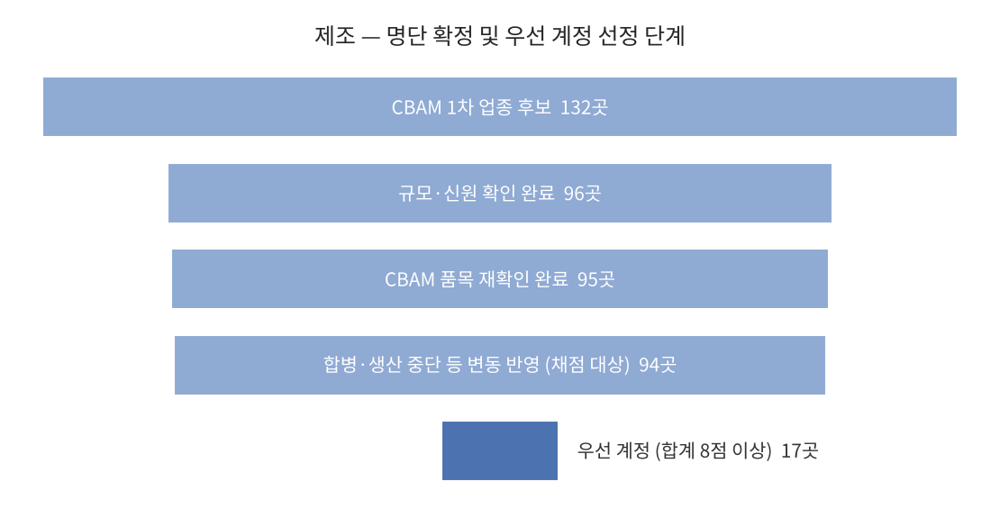

### Ⅲ-1.2 채점 기준 5개 (기준별 0·1·2점, 만점 10점)

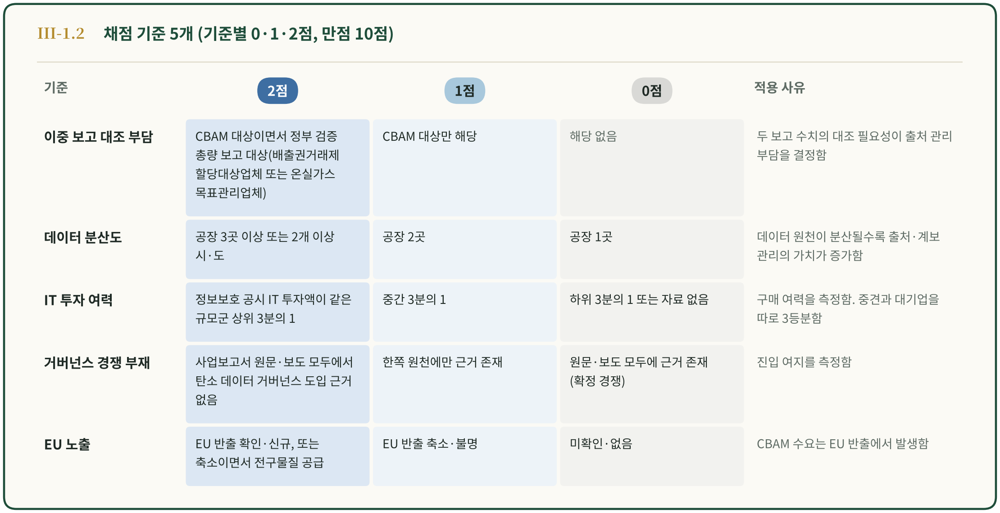

표 원문 보기

| 기준 | 2점 | 1점 | 0점 | 적용 사유 |
|---|---|---|---|---|
| 이중 보고 대조 부담 | CBAM 대상이면서 정부 검증 총량 보고 대상(배출권거래제 할당대상업체 또는 온실가스 목표관리업체) | CBAM 대상만 해당 | — | 두 보고 수치의 대조 필요성이 출처 관리 부담을 결정함 |
| 데이터 분산도 | 공장 3곳 이상 또는 2개 이상 시·도 | 공장 2곳 | 공장 1곳 | 데이터 원천이 분산될수록 출처·계보 관리의 가치가 증가함 |
| IT 투자 여력 | 정보보호 공시 IT 투자액이 같은 규모군 상위 3분의 1 | 중간 3분의 1 | 하위 3분의 1 또는 자료 없음 | 구매 여력을 측정함. 중견과 대기업을 따로 3등분함 |
| 거버넌스 경쟁 부재 | 사업보고서 원문·보도 모두에서 탄소 데이터 거버넌스 도입 근거 없음 | 한쪽 원천에만 근거 존재 | 원문·보도 모두에 근거 존재 (확정 경쟁) | 진입 여지를 측정함 |
| EU 노출 | EU 반출 확인·신규, 또는 축소이면서 전구물질 공급 | EU 반출 축소·불명 | 미확인·없음 | CBAM 수요는 EU 반출에서 발생함 |

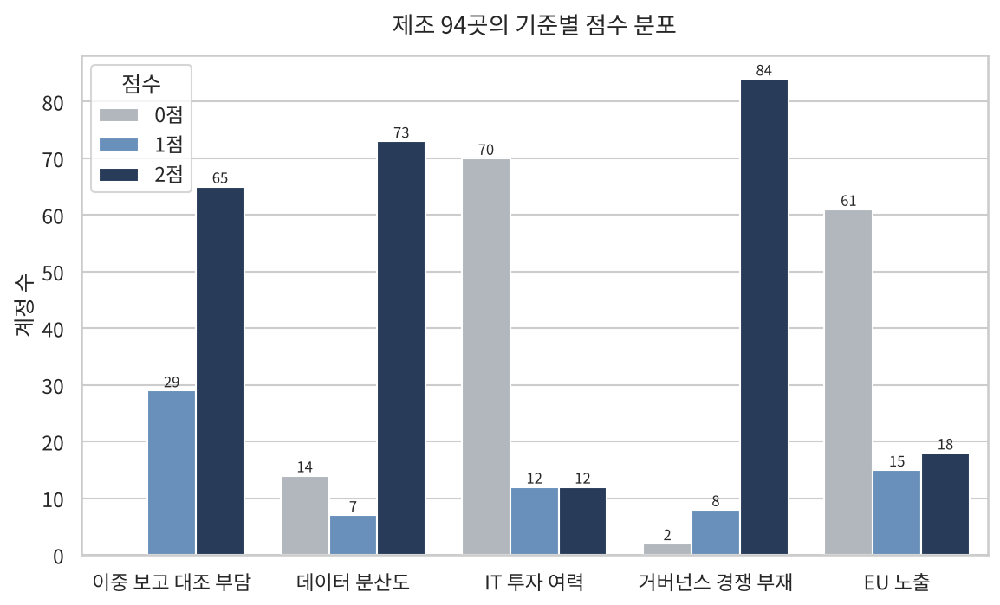

### Ⅲ-1.3 가설 검증 — 제조사의 탄소 데이터 근거 관리 층 공백

**① 현황**

- 탄소 데이터 4층 구조 중 수집·산정 층은 정부 공급망 탄소 데이터 스페이스와 국내 탄소 산정 앱이 담당할 예정이며, 근거 관리 층은 공개 자료 범위에서 탄소 전용 공급자가 확인되지 않음 (Ⅱ-4.1)

**② 가설과 판정 기준 (검증 전 확정)**

- 가설: CBAM 1차 업종 제조사 94곳의 과반은 탄소 데이터 근거 관리 층이 비어 있음 — 탄소 데이터 거버넌스 솔루션(출처·변경 이력·품질을 관리하는 도구)의 도입이 공개 자료로 확인되지 않음
- 판정 기준
  - 채택: 도입 미확인 제조사(거버넌스 경쟁 부재 1점 이상)가 과반
  - 부분 채택: 과반이나 합계 점수 상위 3분의 1에서 도입 확정 제조사가 과반
  - 기각: 도입 확정 제조사가 과반

**③ 검증**

- 94곳 각각의 사업보고서 원문과 보도에서 탄소 데이터 거버넌스 도입 근거를 확인함 (거버넌스 경쟁 부재 기준, Ⅲ-1.2)
- 결과: 94곳 중 92곳(97.9%) 도입 미확인 · 합계 점수 상위 3분의 1(31곳) 중 도입 확정 1곳

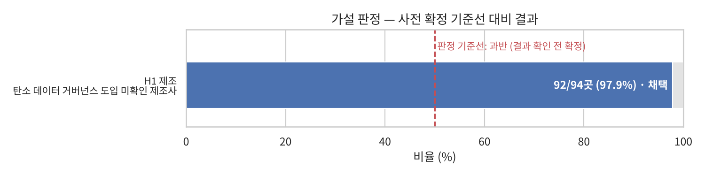

제조사 94곳 중 92곳은 탄소 데이터 근거 관리 층 도입이 공개 자료로 확인되지 않음

**④ 판정 — 채택**

- 도입 미확인 제조사가 과반이며, 상위 3분의 1에서도 도입 확정은 1곳이므로 채택으로 판정함
- 불리한 근거: 공개 자료 범위의 판정이며 비공개 도입은 확인할 수 없음. 공백은 회사 내부의 출처·이력·근거 관리 층으로 한정됨

### Ⅲ-1.4 가설 검증 — 구매 필요성·구매 여력·진입 여지를 동시에 갖춘 제조사의 존재

**① 현황**

- 근거 관리 층 공백은 94곳 중 92곳에서 확인됨 (Ⅲ-1.3)
- 대응이 급한 CBAM 1차 적용 중견 제조사일수록 IT 예산이 작음 (IT 투자 중앙값 14.3억 원, Ⅰ-4.1)

**② 가설과 판정 기준 (검증 전 확정)**

- 가설: 살 이유(구매 필요성 — 이중 보고 대조 부담 2점)·살 돈(구매 여력 — IT 투자 여력 1점 이상, 같은 규모군 IT 투자액 상위 3분의 2)·들어갈 자리(진입 여지 — 거버넌스 경쟁 부재 1점 이상)를 모두 갖춘 제조사가 1곳 이상 존재함
- 판정 기준: 채택 — 1곳 이상 / 기각 — 0곳

**③ 검증**

- 채점 기준 3개(이중 보고 대조 부담·IT 투자 여력·거버넌스 경쟁 부재)를 동시에 충족하는 제조사를 94곳에서 집계함
- 결과: 20곳 (중견 14 · 대기업군 6)

**④ 판정 — 채택**

- 동시 충족 제조사가 20곳 존재하므로 채택으로 판정함
- 용도: 존재 확인용이며 우선 계정 선정에는 사용하지 않음 (데이터 분산도·EU 노출이 빠져 있어 적용 시 EU 노출 확인 4곳이 누락되고 EU 노출이 없는 7곳이 포함됨)
- 불리한 근거: IT 투자액은 정보보호 공시 대상 기업에만 존재함. 구축·연동 비용은 확인하지 못함

### Ⅲ-1.5 우선 계정 선정

- 1단계 점수 분포 확인: 94곳의 5개 기준 합계 점수 분포를 확인함

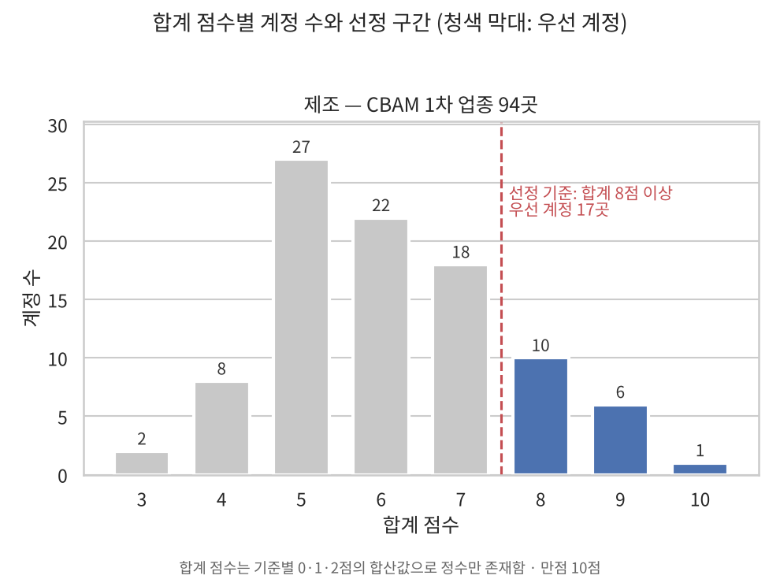

- 2단계 선정 선 결정: 7점 구간(18곳)은 단일 집단이므로 분할 시 동일 점수 간 선정 여부가 갈리게 되어, 선을 8점에 둠
- 3단계 선정 결과: 합계 8점 이상 17곳 (중견 10 · 대기업군 7)

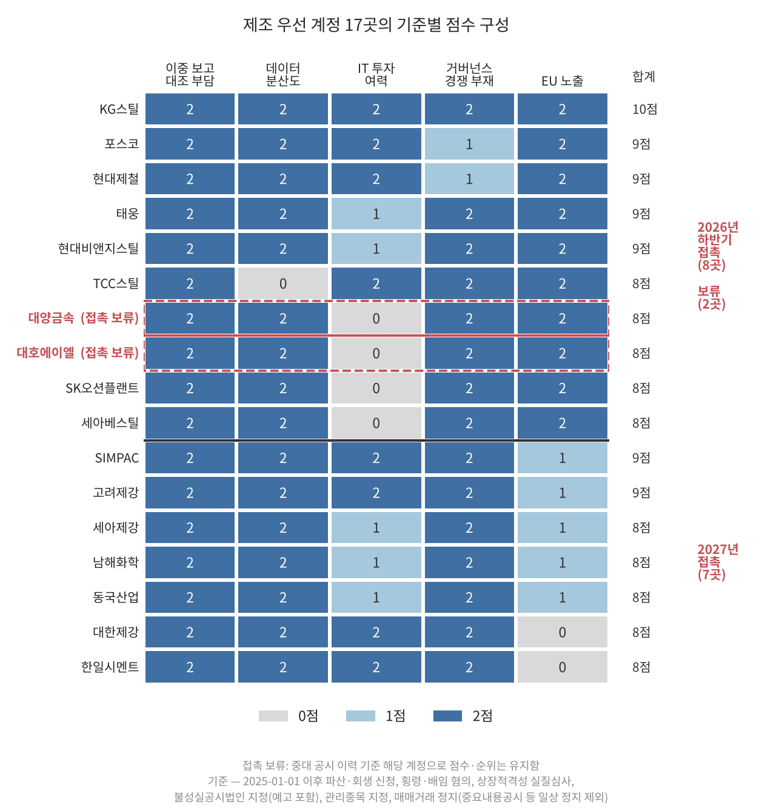

회색 칸이 각 회사의 약점이며, 다섯 기준 모두 2점인 KG스틸이 1위임

- 4단계 접촉 보류 판정: 17곳 전체의 DART 공시를 아래 기준으로 대조함 (공시 제목 기준, 2025-01-01\~2026-10-15)
  - 보류 기준: 2025-01-01 이후 다음 공시 이력 보유 — 파산·회생 신청(제3자 신청·취하·기각 포함), 횡령·배임 혐의, 상장적격성 실질심사, 불성실공시법인 지정(예고 포함), 관리종목 지정, 매매거래 정지(중요내용공시 등 일상 정지 제외)
  - 대양금속: 제3자 파산신청 2건(취하·기각), 불성실공시법인 지정예고(2026-09-23), 매매거래 정지 → 접촉 보류
  - 대호에이엘: 2025 사업연도 감사의견 의견거절, 2026 반기 의견거절, 상장폐지 결정(2026-08, 가처분 신청), 횡령·배임 공시 → 접촉 보류
  - 나머지 15곳: 해당 없음
  - 보류 2곳은 점수와 순위를 유지하고 접촉만 보류함

### Ⅲ-1.6 접촉 시기

- 근거: 2027-02-01 인증서 판매와 2027-09-30 첫 연례 신고 이전에 EU 수입자의 실측 데이터 요청이 발생하며, 기본값 할증이 해마다 확대됨 (Ⅱ-1.1)
- 규칙: EU 노출이 확인되었거나 신규인 계정은 첫 신고 전인 2026년 하반기, EU 노출이 축소·불명·미확인인 계정은 2027년에 접촉함
- 2026년 하반기 8곳 (+ 접촉 보류 2곳): KG스틸 · 포스코 · 현대제철 · 태웅 · 현대비앤지스틸 · TCC스틸 · SK오션플랜트 · 세아베스틸
- 2027년 7곳 (EU 노출 축소 2 · 불명 3 · 미확인 2): SIMPAC · 고려제강 · 세아제강 · 남해화학 · 동국산업 · 대한제강 · 한일시멘트

<b>Ⅲ-2. 금융 트랙 — 금융회사</b>

### Ⅲ-2.1 채점 대상 확정

- 포함 규칙(네 층): 코스피 상장 금융사(연결자산 2조 원 이상) · 그 종속 금융회사 · 명단 밖 코스피 상장사의 종속 금융회사 · 비상장 비종속 금융회사(자산 2조 원 이상 — 대기업집단 소속·공공금융기관·독립·외국계)
- 자산 2조 원 기준: ESG 공시 확대 일정의 마지막 단계(2028년 10조 → 2029년 5조 → 2030년 2조 원 검토)이므로, 이 선으로 자르면 10조·5조 원 이상 회사는 자동으로 포함됨. 회사별 공시 시작 연도(2028년 169 · 2029년 12 · 2030년 검토 15 · 알리오 7 · 대상 아님 47 · 지배회사 2조 미만 28)는 접촉 시기(Ⅲ-2.5)에 반영함
- 제외: 포트폴리오가 없는 법인(보험대리점·손해사정·IT·대부업·신용정보사), 펀드·SPC·신탁 상품, 해외 법인 등
- 층별 수집 순서와 결과
  - 코스피 상장 금융사 40곳
  - 금융 모회사의 종속 118곳 (+ 손자회사 1곳)
  - 명단 밖 코스피 모회사의 종속 65곳
  - 대기업집단 소속 비상장 21곳
  - 공공금융기관 5곳 (+ 공공기관 종속 2곳)
  - 독립·외국계 26곳
- 결과: 채점 대상 278곳 (은행 18 · 금융지주 10 · 공공 5 · 카드·캐피탈 41 · 증권 31 · 생명보험 20 · 손해보험 15 · 저축은행 28 · 자산운용·신탁 75 · 기타 35)

### Ⅲ-2.2 채점 기준 4개 (기준별 0·1·2점, 만점 8점)

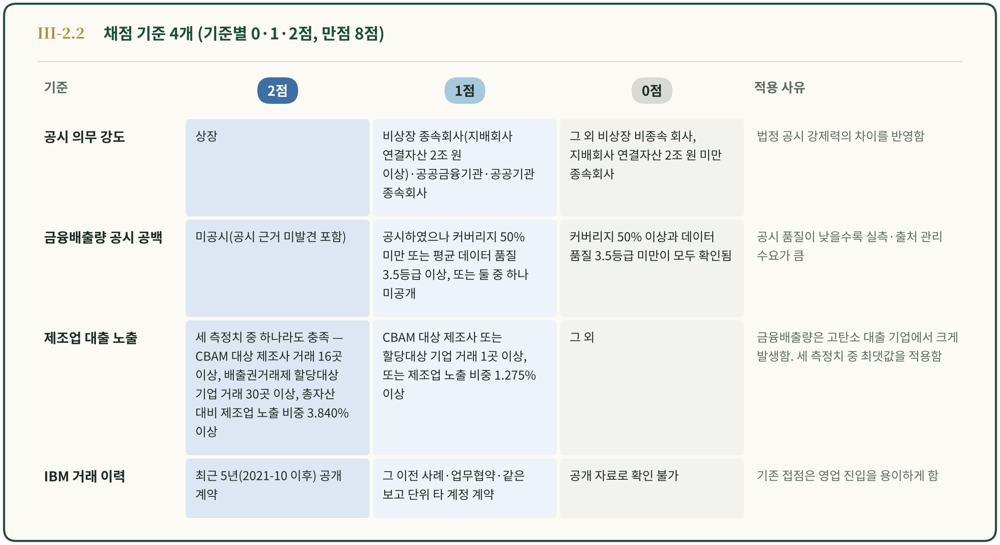

표 원문 보기

| 기준 | 2점 | 1점 | 0점 | 적용 사유 |
|---|---|---|---|---|
| 공시 의무 강도 | 상장 | 비상장 종속회사(지배회사 연결자산 2조 원 이상)·공공금융기관·공공기관 종속회사 | 그 외 비상장 비종속 회사, 지배회사 연결자산 2조 원 미만 종속회사 | 법정 공시 강제력의 차이를 반영함 |
| 금융배출량 공시 공백 | 미공시(공시 근거 미발견 포함) | 공시하였으나 커버리지 50% 미만 또는 평균 데이터 품질 3.5등급 이상, 또는 둘 중 하나 미공개 | 커버리지 50% 이상과 데이터 품질 3.5등급 미만이 모두 확인됨 | 공시 품질이 낮을수록 실측·출처 관리 수요가 큼 |
| 제조업 대출 노출 | 세 측정치 중 하나라도 충족 — CBAM 대상 제조사 거래 16곳 이상, 배출권거래제 할당대상 기업 거래 30곳 이상, 총자산 대비 제조업 노출 비중 3.840% 이상 | CBAM 대상 제조사 또는 할당대상 기업 거래 1곳 이상, 또는 제조업 노출 비중 1.275% 이상 | 그 외 | 금융배출량은 고탄소 대출 기업에서 크게 발생함. 세 측정치 중 최댓값을 적용함 |
| IBM 거래 이력 | 최근 5년(2021-10 이후) 공개 계약 | 그 이전 사례·업무협약·같은 보고 단위 타 계정 계약 | 공개 자료로 확인 불가 | 기존 접점은 영업 진입을 용이하게 함 |

- Ⅰ-3.5 남은 질문과의 연결: '아직 체계를 갖추지 못한 금융사'를 공개 자료로 찾는 기준이 금융배출량 공시 공백임 — 공시가 없거나 범위·품질이 낮을수록 우선함
- 공시 공백의 불이익
  - 2026-10 기준 금융배출량 공시는 자율이므로 공시하지 않아도 법적 불이익은 없음
  - 2031년부터 자산 10조 원 이상 상장 금융사(연결 종속회사 포함)는 사업보고서에 금융배출량을 공시해야 하며, 누락·허위 공시는 자본시장법상 제재(손해배상·행정제재) 대상이 됨. 추정치·대출 기업에서 받은 수치는 합리적 근거를 갖춰 충실히 공시한 경우에만 손해배상·행정책임이 면제됨 (Ⅱ-1.2)
  - 비상장 공공금융기관(산업은행·수출입은행 등)은 자본시장법 공시 대상이 아니며, 공공기관 통합공시(알리오)의 금융배출량 공시 확대와 경영평가 연계가 예고됨
- 자체 산정 체계
  - 대출 기업의 배출량(공시값·정부 명세서·추정치)을 모아 PCAF 산식으로 대출 비율만큼 배분하고 자산군별 금융배출량을 계산·기록하는 금융회사 내부 시스템임
  - 사례: 기업은행은 2020년부터 산정함 · 수출입은행은 2023년 PCAF 가입 후 7개 자산군을 자체 산정했고 전산 시스템을 구축 중임
  - 정부가 산정 체계 자체를 승인·인증하는 제도는 공개 자료로 확인되지 않음. 제도상 인정 경로는 2030년부터 의무화 예정인 공시 수치의 제3자 인증(금융배출량 포함 여부·범위 미정)과, 2031년 이후 추정치를 합리적 근거로 공시했음을 입증해 받는 면책임
- 불리한 근거: 신한·기업은행·수출입은행처럼 자체 산정 체계를 갖춘 곳도 있어, 공시 공백이 곧 '자체 체계 없음'을 의미하지는 않음

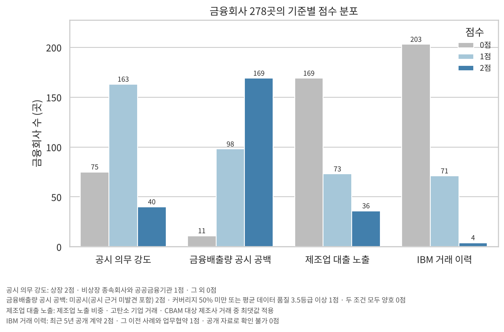

### Ⅲ-2.3 가설 검증 — 금융회사의 대출 기업 배출량 근거 관리 공백

**① 현황**

- 금융배출량 공시는 2026-10 기준 자율이며, 정부 최종안 기준 2031년에 공시가 시작됨 (Ⅱ-1.2)
- 신용정보원 금융배출량 플랫폼(2026-02 대출 1차): 금융회사가 함께 쓰는 금융배출량 계산 도구임. 기업별 공시 배출량과 중소·비상장 추정치를 제공하고 PCAF 산식으로 자동 산출함. 자율 참고용이며 자산군(대출 → 전체)·이용 범위(은행권 → 전 금융권)를 넓힐 계획임 — 수집·산정 층 (Ⅱ-1.2·Ⅱ-4.1)

**② 가설과 판정 기준 (검증 전 확정)**

- 가설: 금융회사 278곳의 과반은 대출 기업 배출량 데이터가 부족하며(금융배출량 공시 공백 1점 이상), 신용정보원 금융배출량 플랫폼은 금융회사별 출처 구분(플랫폼 추정치와 대출 기업 실측치의 구분)·변경 이력·인증 대비 증빙을 담당하지 않음
- 판정 기준
  - 채택: 공시 공백 1점 이상이 과반이고 플랫폼의 해당 영역 확대 공식 계획이 없음
  - 부분 채택: 공시 공백 조건만 충족
  - 기각: 해당 영역 확대 공식 계획이 확인되거나 공시 공백 0점이 과반

**③ 검증**

- 278곳의 금융배출량 공시 공백 점수를 집계하고(Ⅲ-2.2), 신용정보원 플랫폼의 해당 영역 확대 공식 계획 여부를 확인함 (확인 2026-10-07)
  - 공시 공백 확인 경로: 금융그룹 단위(보고 단위 150개)로, 공시 가능성이 큰 곳(금융지주·PCAF 가입사·대형 보험·카드·증권·정책금융기관)부터 회사 보도자료·홈페이지, 국회 제출 자료, 신용평가사, 주요 언론에서 금융배출량 수치·커버리지·품질 등급을 찾음. 종속회사는 그룹 보고서 값을 적용함
  - 결과 근거: 공시 근거 확인 109곳(근거 25건 — KB·신한·하나·우리·농협·JB·iM·IBK·주요 보험사 등, 그중 15곳은 측정 시스템·목표만 공개) · 미공시 확인 3곳(산업은행·KDB생명·산은캐피탈) · 근거를 찾지 못한 166곳은 미공시로 보아 2점을 줌
  - 한계: 지속가능경영보고서 원문(PDF) 대조는 하지 못해 원문 대조 1순위 16곳으로 남김
- 결과: 공시 공백 1점 이상 278곳 중 267곳(96.0%) · 보고 단위 150개 중 149개 · 우선 계정 37곳 중 35곳. 플랫폼의 해당 영역 확대 공식 계획 없음

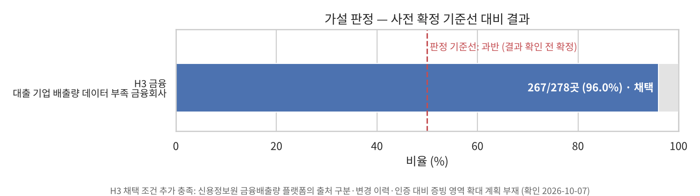

금융회사 278곳 중 267곳은 대출 기업 배출량 데이터가 부족함

**④ 판정 — 채택**

- 공시 공백이 과반이고 플랫폼의 해당 영역 확대 계획이 없으므로 채택으로 판정함
- 불리한 근거: 공시 공백 2점 169곳 중 166곳은 '공시 근거 미발견'이며 미공시가 확인된 곳은 3곳임 · 금융배출량 공시는 2026-10 기준 자율임 · 플랫폼이 해당 영역 확대를 발표하면 기각으로 전환됨

### Ⅲ-2.4 우선 계정 선정

- 1단계 점수 분포 확인: 278곳의 4개 기준 합계 점수 분포를 확인함

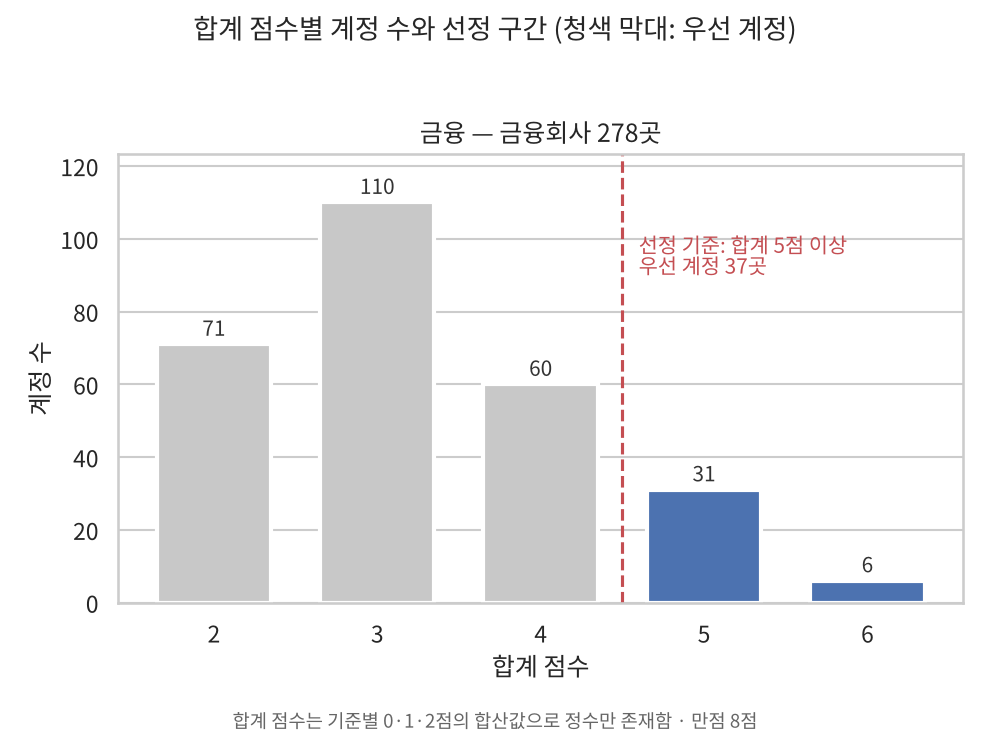

- 2단계 선정 선 결정: 분포상 뚜렷한 단절이 없어 제조 트랙과 동일하게 점수 구간 경계로 선정함 — 6점 이상은 6곳으로 과소, 4점 이상은 35%로 과다하여 선을 5점에 둠
- 3단계 선정 결과: 합계 5점 이상 37곳 (보고 단위 23개)

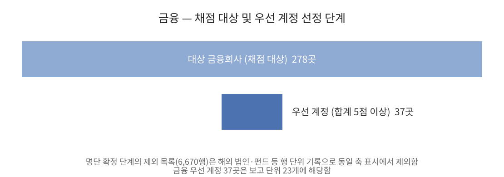

점수 분포에 뚜렷한 단절이 없어 동점 집단을 가르지 않는 5점 선에서 37곳을 선정함

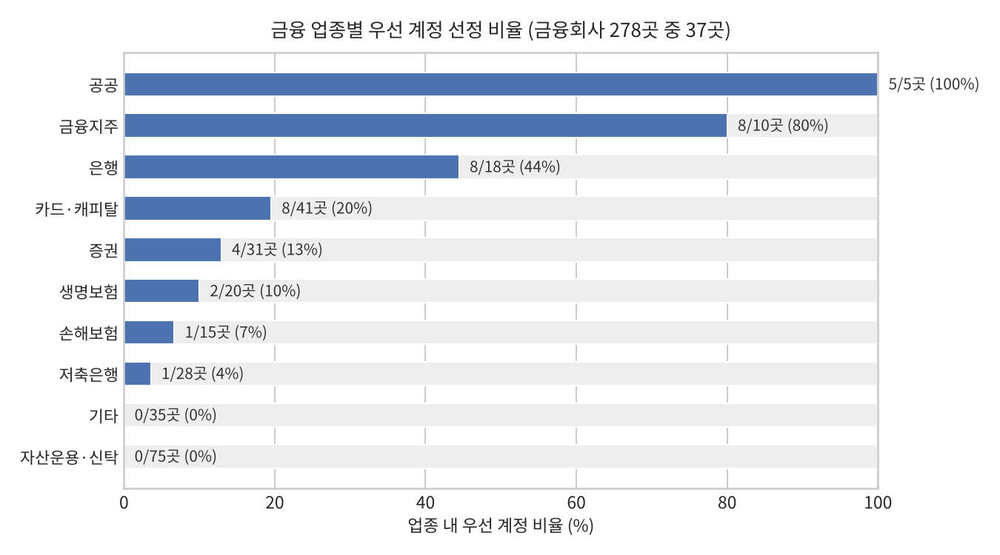

- 같은 금융그룹의 계열사는 지주회사·그룹 IT 자회사가 영업 창구를 맡으므로 그룹당 한 번만 접촉해 중복 접촉을 피함 → 우선 계정 37곳의 접촉 단위는 23개임 (금융그룹 6개 · 단독 17곳)

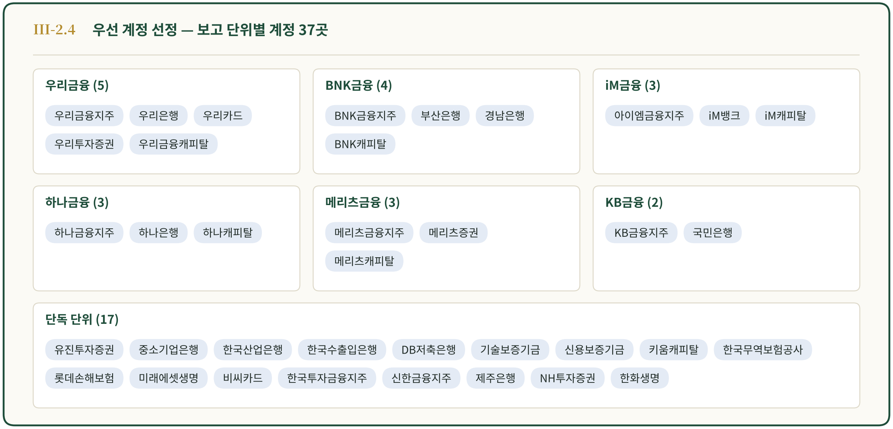

표 원문 보기

| 보고 단위 | 계정 |
|---|---|
| 우리금융 (5) | 우리금융지주 · 우리은행 · 우리카드 · 우리투자증권 · 우리금융캐피탈 |
| BNK금융 (4) | BNK금융지주 · 부산은행 · 경남은행 · BNK캐피탈 |
| iM금융 (3) | 아이엠금융지주 · iM뱅크 · iM캐피탈 |
| 하나금융 (3) | 하나금융지주 · 하나은행 · 하나캐피탈 |
| 메리츠금융 (3) | 메리츠금융지주 · 메리츠증권 · 메리츠캐피탈 |
| KB금융 (2) | KB금융지주 · 국민은행 |
| 단독 단위 (17) | 유진투자증권 · 중소기업은행 · 한국산업은행 · 한국수출입은행 · DB저축은행 · 기술보증기금 · 신용보증기금 · 키움캐피탈 · 한국무역보험공사 · 롯데손해보험 · 미래에셋생명 · 비씨카드 · 한국투자금융지주 · 신한금융지주 · 제주은행 · NH투자증권 · 한화생명 |

### Ⅲ-2.5 접촉 시기

- 근거: 정부 최종안 기준 금융배출량 공시 시작(자산 10조 원 이상 2031년)의 준비 마감이 2029년 말이며, 제3자 인증이 2030년에 시작됨 (Ⅱ-1.2)
- 규칙: 금융배출량은 ESG 공시 시작 3년 뒤 법정 공시가 되므로, 공시 2년 전을 접촉 시점으로 정함 — ESG 공시 2028년(자산 10조 원 이상)·공공기관(알리오 공시) → 2029년 / ESG 공시 2029년(5조 원)·2030년 검토(2조 원)·해당 없음 → 2030년
- 결과: 2029년 36곳 (보고 단위 22개) · 2030년 1곳 (제주은행)

<b>Ⅲ-3. 연도별 진입 로드맵</b>

### Ⅲ-3.1 접촉 순서

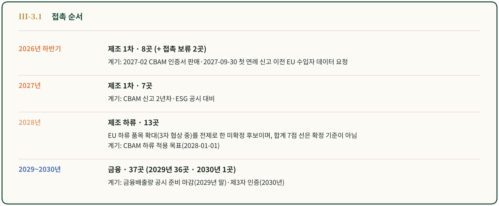

표 원문 보기

| 연도 | 트랙 | 계정 수 | 계기 |
|---|---|---|---|
| 2026년 하반기 | 제조 1차 | 8곳 (+ 접촉 보류 2곳) | 2027-02 CBAM 인증서 판매·2027-09-30 첫 연례 신고 이전 EU 수입자 데이터 요청 |
| 2027년 | 제조 1차 | 7곳 | CBAM 신고 2년차·ESG 공시 대비 |
| 2028년 | 제조 하류 | 13곳 — EU 하류 품목 확대(3자 협상 중)를 전제로 한 미확정 후보이며, 합계 7점 선은 확정 기준이 아님 | CBAM 하류 적용 목표(2028-01-01) |
| 2029\~2030년 | 금융 | 37곳 (2029년 36곳 · 2030년 1곳) | 금융배출량 공시 준비 마감(2029년 말)·제3자 인증(2030년) |

- 제조 하류 2028년 후보 13곳: 삼기 · HD건설기계 · HD현대일렉트릭 · HL만도 · 일진전기 · 효성중공업 · 경창산업 · 대한전선 · 평화산업 · 대동 · SNT다이내믹스 · SNT모티브 · 지엠비코리아

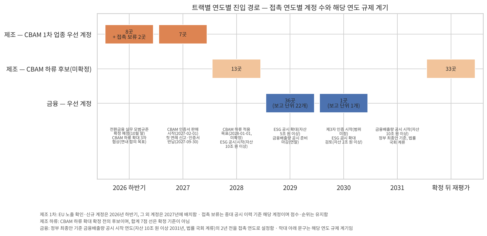

제조사는 CBAM 첫 신고 전인 2026년 하반기부터, 금융회사는 공시 2년 전인 2029년에 접촉함

---

## 📌 Ⅳ 결론 — 어디에 무엇을 파는가

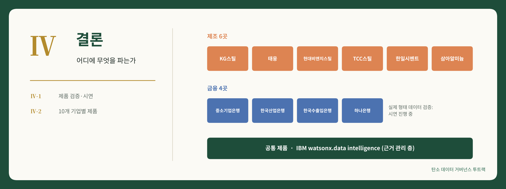

<b>Ⅳ-1. 제품 검증 — watsonx.data intelligence의 공백 충족 가능 여부·시연 진행 상황</b>

### Ⅳ-1.1 가설 검증 — 판매 제품의 출처·계보 공백 충족

**① 현황**

- 제조사 94곳 중 92곳, 금융회사 278곳 중 267곳에서 근거 관리 층 공백이 확인됨 (Ⅲ-1.3·Ⅲ-2.3)
- 판매 제품이 채워야 할 기능은 탄소 수치의 출처·변경 이력·판단 근거의 추적임 (Ⅱ-4.1)

**② 가설과 판정 기준 (검증 전 확정)**

- 가설: IBM watsonx.data intelligence는 제조사·금융회사의 탄소 데이터 흐름을 추적해 출처·계보 공백을 채울 수 있음
- 판정 기준
  - 채택: 주요 구간의 자동 추적이 확인됨
  - 부분 채택: SQL·ETL 구간만 추적됨
  - 기각: 주요 구간 추적 불가

**③ 검증 (IBM 공식 문서 기준)**

- 데이터베이스·ETL·리포팅·모델링 도구와 Java·C# 코드는 자동 추적함
- Python은 주석을 단 스크립트만 추적하며, 엑셀은 제품 구성에 따라 다름
- 비교 제품: Databricks Unity Catalog는 추가 비용 없이 계보를 포함하고 Snowflake Horizon은 기본 내장됨

**④ 판정 — 부분 채택**

- 주요 구간 중 SQL·ETL 계열만 자동 추적이 확인되므로 부분 채택으로 판정함
- 결론 적용 조건: SQL·ETL 중심 흐름은 자동 추적 가능함. 엑셀·Python 중심 산정(중견 제조사 CBAM 산정이 해당될 수 있음)은 주석·OpenLineage 연결로 보완해야 함
- 불리한 근거: 실제 형태 데이터 적용 검증 전임 (시연 진행 중 — Ⅳ-1.2) · Databricks·Snowflake 중심 고객에서는 비교 열위임

### Ⅳ-1.2 시연 진행 상황 (진행 문서 08\~10, 2026-10-14 기준)

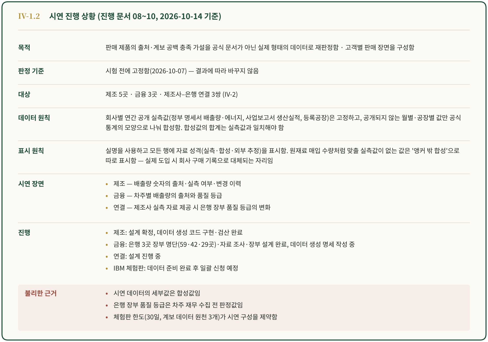

표 원문 보기

| 항목 | 내용 |
|---|---|
| 목적 | 판매 제품의 출처·계보 공백 충족 가설을 공식 문서가 아닌 실제 형태의 데이터로 재판정함 · 고객별 판매 장면을 구성함 |
| 판정 기준 | 시험 전에 고정함(2026-10-07) — 결과에 따라 바꾸지 않음 |
| 대상 | 제조 5곳 · 금융 3곳 · 제조사–은행 연결 3쌍 (Ⅳ-2) |
| 데이터 원칙 | 회사별 연간 공개 실측값(정부 명세서 배출량·에너지, 사업보고서 생산실적, 등록공장)은 고정하고, 공개되지 않는 월별·공장별 값만 공식 통계의 모양으로 나눠 합성함. 합성값의 합계는 실측값과 일치해야 함 |
| 표시 원칙 | 실명을 사용하고 모든 행에 자료 성격(실측·합성·외부 추정)을 표시함. 원재료 매입 수량처럼 맞출 실측값이 없는 값은 '앵커 밖 합성'으로 따로 표시함 — 실제 도입 시 회사 구매 기록으로 대체되는 자리임 |
| 시연 장면 | 제조 — 배출량 숫자의 출처·실측 여부·변경 이력 / 금융 — 차주별 배출량의 출처와 품질 등급 / 연결 — 제조사 실측 자료 제공 시 은행 장부 품질 등급의 변화 |
| 진행 | 제조: 설계 확정, 데이터 생성 코드 구현·검산 완료 / 금융: 은행 3곳 장부 명단(59·42·29곳)·자료 조사·장부 설계 완료, 데이터 생성 명세 작성 중 / 연결: 설계 진행 중 / IBM 체험판: 데이터 준비 완료 후 일괄 신청 예정 |
| 불리한 근거 | 시연 데이터의 세부값은 합성값임 · 은행 장부 품질 등급은 차주 재무 수집 전 판정값임 · 체험판 한도(30일, 계보 데이터 원천 3개)가 시연 구성을 제약함 |

<b>Ⅳ-2. 어디에 무엇을 — 10개 기업별 IBM 제품</b>

### Ⅳ-2.1 10개 기업 선정 과정

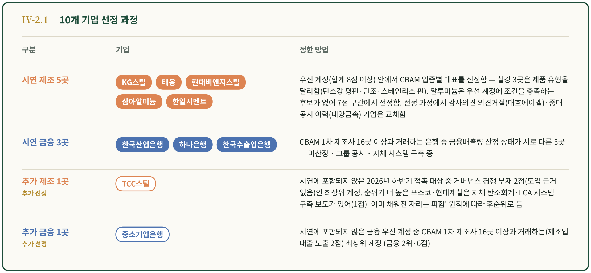

표 원문 보기

| 구분 | 기업 | 정한 방법 |
|---|---|---|
| 시연 제조 5곳 | KG스틸 · 태웅 · 현대비앤지스틸 · 삼아알미늄 · 한일시멘트 | 우선 계정(합계 8점 이상) 안에서 CBAM 업종별 대표를 선정함 — 철강 3곳은 제품 유형을 달리함(탄소강 평판·단조·스테인리스 판). 알루미늄은 우선 계정에 조건을 충족하는 후보가 없어 7점 구간에서 선정함. 선정 과정에서 감사의견 의견거절(대호에이엘)·중대 공시 이력(대양금속) 기업은 교체함 |
| 시연 금융 3곳 | 한국산업은행 · 하나은행 · 한국수출입은행 | CBAM 1차 제조사 16곳 이상과 거래하는 은행 중 금융배출량 산정 상태가 서로 다른 3곳 — 미산정 · 그룹 공시 · 자체 시스템 구축 중 |
| 추가 제조 1곳 | TCC스틸 | 시연에 포함되지 않은 2026년 하반기 접촉 대상 중 거버넌스 경쟁 부재 2점(도입 근거 없음)인 최상위 계정. 순위가 더 높은 포스코·현대제철은 자체 탄소회계·LCA 시스템 구축 보도가 있어(1점) '이미 채워진 자리는 피함' 원칙에 따라 후순위로 둠 |
| 추가 금융 1곳 | 중소기업은행 | 시연에 포함되지 않은 금융 우선 계정 중 CBAM 1차 제조사 16곳 이상과 거래하는(제조업 대출 노출 2점) 최상위 계정 (금융 2위·6점) |

- 연결 3쌍(시연): KG스틸 → 하나은행 · 한일시멘트 → 한국산업은행 · 삼아알미늄 → 한국수출입은행 — 제조사의 실측 배출량이 대출 은행 금융배출량의 입력값이 되는 관계임
- 숫자 기준 차이: Ⅱ-3.1의 산업은행 거래 58곳은 진행 문서 04 기준이며, Ⅳ-2의 59곳은 시연 단계에서 원문 대조로 1곳을 보정한 값임. 수출입은행도 같은 방식으로 28곳 → 29곳이 됨

### Ⅳ-2.2 기업별 근거

- 기업명을 누르면 해당 기업의 근거 도식이 열림

<b>1. KG스틸 — 원재료 원산지 증빙이 신고값을 좌우하는 냉연·도금 강판 회사</b>

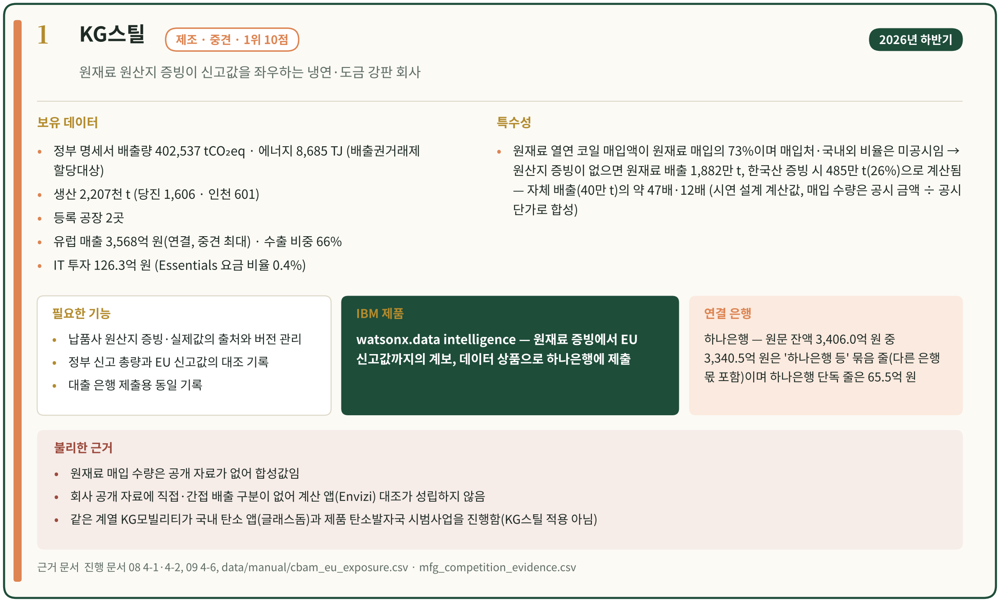

표 원문 보기

| 항목 | 내용 |
|---|---|
| 보유 데이터 (공개 실측, 2025) | 정부 명세서 배출량 402,537 tCO₂eq · 에너지 8,685 TJ (배출권거래제 할당대상) / 생산 2,207천 t (당진 1,606 · 인천 601) / 등록 공장 2곳 / 유럽 매출 3,568억 원(연결, 중견 최대) · 수출 비중 66% / IT 투자 126.3억 원 (Essentials 요금 비율 0.4%) |
| 특수성 | 원재료 열연 코일 매입액이 원재료 매입의 73%이며 매입처·국내외 비율은 미공시임 → 원산지 증빙이 없으면 원재료 배출 1,882만 t, 한국산 증빙 시 485만 t(26%)으로 계산됨 — 자체 배출(40만 t)의 약 47배·12배 (시연 설계 계산값, 매입 수량은 공시 금액 ÷ 공시 단가로 합성) |
| 필요한 기능 | 납품사 원산지 증빙·실제값의 출처와 버전 관리 · 정부 신고 총량과 EU 신고값의 대조 기록 · 대출 은행 제출용 동일 기록 |
| IBM 제품 | watsonx.data intelligence — 원재료 증빙에서 EU 신고값까지의 계보, 데이터 상품으로 하나은행에 제출 |
| 연결 은행 | 하나은행 — 원문 잔액 3,406.0억 원 중 3,340.5억 원은 '하나은행 등' 묶음 줄(다른 은행 몫 포함)이며 하나은행 단독 줄은 65.5억 원 |
| 불리한 근거 | 원재료 매입 수량은 공개 자료가 없어 합성값임 · 회사 공개 자료에 직접·간접 배출 구분이 없어 계산 앱(Envizi) 대조가 성립하지 않음 · 같은 계열 KG모빌리티가 국내 탄소 앱(글래스돔)과 제품 탄소발자국 시범사업을 진행함(KG스틸 적용 아님) |
| 근거 문서 | 진행 문서 08 4-1·4-2, 09 4-6, data/manual/cbam_eu_exposure.csv · mfg_competition_evidence.csv |

<b>2. 태웅 — 공장 간 이동 기록이 필요한 자체 제강·단조 회사</b>

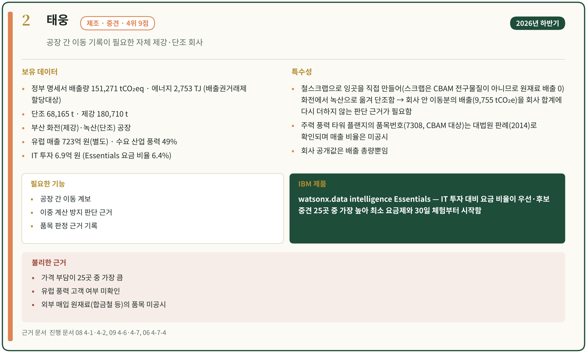

표 원문 보기

| 항목 | 내용 |
|---|---|
| 보유 데이터 (공개 실측, 2025) | 정부 명세서 배출량 151,271 tCO₂eq · 에너지 2,753 TJ (배출권거래제 할당대상) / 단조 68,165 t · 제강 180,710 t / 부산 화전(제강)·녹산(단조) 공장 / 유럽 매출 723억 원(별도) · 수요 산업 풍력 49% / IT 투자 6.9억 원 (Essentials 요금 비율 6.4%) |
| 특수성 | 철스크랩으로 잉곳을 직접 만들어(스크랩은 CBAM 전구물질이 아니므로 원재료 배출 0) 화전에서 녹산으로 옮겨 단조함 → 회사 안 이동분의 배출(9,755 tCO₂e)을 회사 합계에 다시 더하지 않는 판단 근거가 필요함 · 주력 풍력 타워 플랜지의 품목번호(7308, CBAM 대상)는 대법원 판례(2014)로 확인되며 매출 비율은 미공시 · 회사 공개값은 배출 총량뿐임 |
| 필요한 기능 | 공장 간 이동 계보 · 이중 계산 방지 판단 근거 · 품목 판정 근거 기록 |
| IBM 제품 | watsonx.data intelligence Essentials — IT 투자 대비 요금 비율이 우선·후보 중견 25곳 중 가장 높아 최소 요금제와 30일 체험부터 시작함 |
| 불리한 근거 | 가격 부담이 25곳 중 가장 큼 · 유럽 풍력 고객 여부 미확인 · 외부 매입 원재료(합금철 등)의 품목 미공시 |
| 근거 문서 | 진행 문서 08 4-1·4-2, 09 4-6·4-7, 06 4-7-4 |

<b>3. 현대비앤지스틸 — 공장마다 CBAM 범위가 갈리는 스테인리스 판 회사</b>

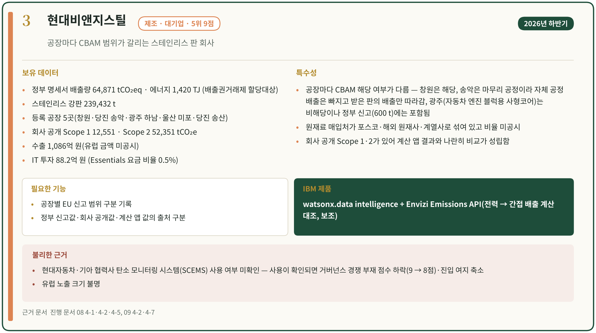

표 원문 보기

| 항목 | 내용 |
|---|---|
| 보유 데이터 (공개 실측, 2025) | 정부 명세서 배출량 64,871 tCO₂eq · 에너지 1,420 TJ (배출권거래제 할당대상) / 스테인리스 강판 239,432 t / 등록 공장 5곳(창원·당진 송악·광주 하남·울산 미포·당진 송산) / 회사 공개 Scope 1 12,551 · Scope 2 52,351 tCO₂e / 수출 1,086억 원(유럽 금액 미공시) / IT 투자 88.2억 원 (Essentials 요금 비율 0.5%) |
| 특수성 | 공장마다 CBAM 해당 여부가 다름 — 창원은 해당, 송악은 마무리 공정이라 자체 공정 배출은 빠지고 받은 판의 배출만 따라감, 광주(자동차 엔진 블럭용 사형코어)는 비해당이나 정부 신고(600 t)에는 포함됨 · 원재료 매입처가 포스코·해외 원재사·계열사로 섞여 있고 비율 미공시 · 회사 공개 Scope 1·2가 있어 계산 앱 결과와 나란히 비교가 성립함 |
| 필요한 기능 | 공장별 EU 신고 범위 구분 기록 · 정부 신고값·회사 공개값·계산 앱 값의 출처 구분 |
| IBM 제품 | watsonx.data intelligence + Envizi Emissions API(전력 → 간접 배출 계산 대조, 보조) |
| 불리한 근거 | 현대자동차·기아 협력사 탄소 모니터링 시스템(SCEMS) 사용 여부 미확인 — 사용이 확인되면 거버넌스 경쟁 부재 점수 하락(9 → 8점)·진입 여지 축소 · 유럽 노출 크기 불명 |
| 근거 문서 | 진행 문서 08 4-1·4-2·4-5, 09 4-2·4-7 |

<b>4. TCC스틸 (추가) — 단일 공급사 원판에 도금하는 공장 1곳 회사</b>

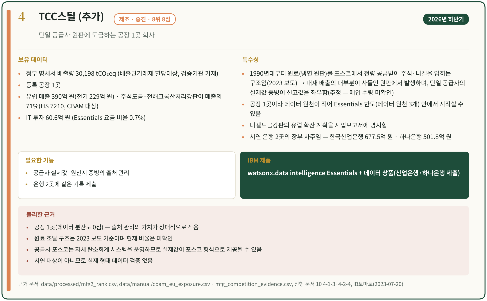

표 원문 보기

| 항목 | 내용 |
|---|---|
| 보유 데이터 (공개 실측, 2025) | 정부 명세서 배출량 30,198 tCO₂eq (배출권거래제 할당대상, 검증기관 기재) / 등록 공장 1곳 / 유럽 매출 390억 원(전기 229억 원) · 주석도금·전해크롬산처리강판이 매출의 71%(HS 7210, CBAM 대상) / IT 투자 60.6억 원 (Essentials 요금 비율 0.7%) |
| 특수성 | 1990년대부터 원료(냉연 원판)를 포스코에서 전량 공급받아 주석·니켈을 입히는 구조임(2023 보도) → 내재 배출의 대부분이 사들인 원판에서 발생하며, 단일 공급사의 실제값 증빙이 신고값을 좌우함(추정 — 매입 수량 미확인) · 공장 1곳이라 데이터 원천이 적어 Essentials 한도(데이터 원천 3개) 안에서 시작할 수 있음 · 니켈도금강판의 유럽 확산 계획을 사업보고서에 명시함 · 시연 은행 2곳의 장부 차주임 — 한국산업은행 677.5억 원 · 하나은행 501.8억 원 |
| 필요한 기능 | 공급사 실제값·원산지 증빙의 출처 관리 · 은행 2곳에 같은 기록 제출 |
| IBM 제품 | watsonx.data intelligence Essentials + 데이터 상품(산업은행·하나은행 제출) |
| 불리한 근거 | 공장 1곳(데이터 분산도 0점) — 출처 관리의 가치가 상대적으로 작음 · 원료 조달 구조는 2023 보도 기준이며 현재 비율은 미확인 · 공급사 포스코는 자체 탄소회계 시스템을 운영하므로 실제값이 포스코 형식으로 제공될 수 있음 · 시연 대상이 아니므로 실제 형태 데이터 검증 없음 |
| 근거 문서 | data/processed/mfg2_rank.csv, data/manual/cbam_eu_exposure.csv · mfg_competition_evidence.csv, 진행 문서 10 4-1-3·4-2-4, IB토마토(2023-07-20) |

<b>5. 한일시멘트 — 신고 범위 구분이 필요한 최대 배출 시멘트 회사</b>

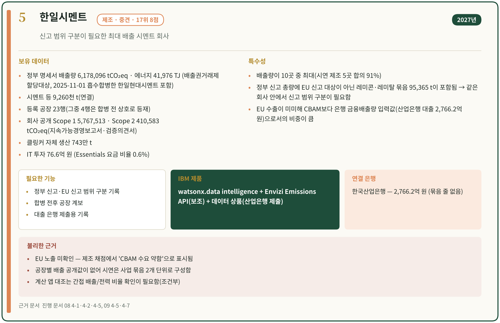

표 원문 보기

| 항목 | 내용 |
|---|---|
| 보유 데이터 (공개 실측, 2025) | 정부 명세서 배출량 6,178,096 tCO₂eq · 에너지 41,976 TJ (배출권거래제 할당대상, 2025-11-01 흡수합병한 한일현대시멘트 포함) / 시멘트 등 9,260천 t(연결) / 등록 공장 23행(그중 4행은 합병 전 상호로 등재) / 회사 공개 Scope 1 5,767,513 · Scope 2 410,583 tCO₂eq(지속가능경영보고서·검증의견서) / 클링커 자체 생산 743만 t / IT 투자 76.6억 원 (Essentials 요금 비율 0.6%) |
| 특수성 | 배출량이 10곳 중 최대(시연 제조 5곳 합의 91%) · 정부 신고 총량에 EU 신고 대상이 아닌 레미콘·레미탈 묶음 95,365 t이 포함됨 → 같은 회사 안에서 신고 범위 구분이 필요함 · EU 수출이 미미해 CBAM보다 은행 금융배출량 입력값(산업은행 대출 2,766.2억 원)으로서의 비중이 큼 |
| 필요한 기능 | 정부 신고·EU 신고 범위 구분 기록 · 합병 전후 공장 계보 · 대출 은행 제출용 기록 |
| IBM 제품 | watsonx.data intelligence + Envizi Emissions API(보조) + 데이터 상품(산업은행 제출) |
| 연결 은행 | 한국산업은행 — 2,766.2억 원 (묶음 줄 없음) |
| 불리한 근거 | EU 노출 미확인 — 제조 채점에서 'CBAM 수요 약함'으로 표시됨 · 공장별 배출 공개값이 없어 시연은 사업 묶음 2개 단위로 구성함 · 계산 앱 대조는 간접 배출/전력 비율 확인이 필요함(조건부) |
| 근거 문서 | 진행 문서 08 4-1·4-2·4-5, 09 4-5·4-7 |

<b>6. 삼아알미늄 — 산정 앱 결과와 원산지 증빙을 함께 관리해야 하는 알루미늄박 회사</b>

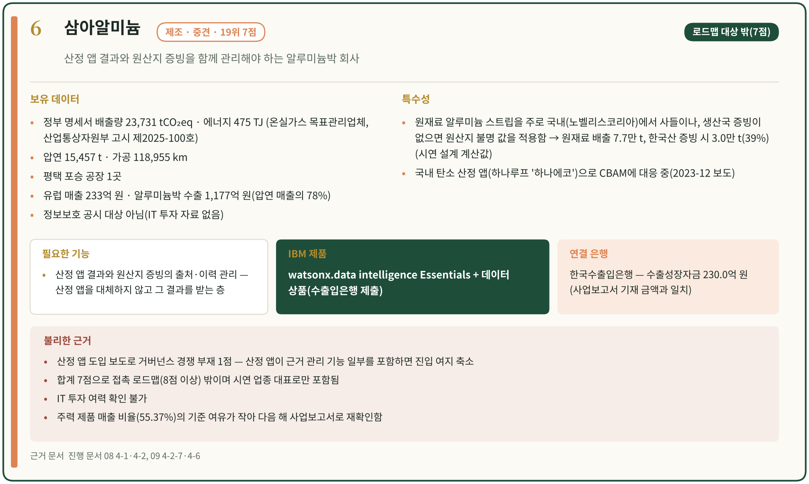

표 원문 보기

| 항목 | 내용 |
|---|---|
| 보유 데이터 (공개 실측, 2025) | 정부 명세서 배출량 23,731 tCO₂eq · 에너지 475 TJ (온실가스 목표관리업체, 산업통상자원부 고시 제2025-100호) / 압연 15,457 t · 가공 118,955 km / 평택 포승 공장 1곳 / 유럽 매출 233억 원 · 알루미늄박 수출 1,177억 원(압연 매출의 78%) / 정보보호 공시 대상 아님(IT 투자 자료 없음) |
| 특수성 | 원재료 알루미늄 스트립을 주로 국내(노벨리스코리아)에서 사들이나, 생산국 증빙이 없으면 원산지 불명 값을 적용함 → 원재료 배출 7.7만 t, 한국산 증빙 시 3.0만 t(39%) (시연 설계 계산값) · 국내 탄소 산정 앱(하나루프 '하나에코')으로 CBAM에 대응 중(2023-12 보도) |
| 필요한 기능 | 산정 앱 결과와 원산지 증빙의 출처·이력 관리 — 산정 앱을 대체하지 않고 그 결과를 받는 층 |
| IBM 제품 | watsonx.data intelligence Essentials + 데이터 상품(수출입은행 제출) |
| 연결 은행 | 한국수출입은행 — 수출성장자금 230.0억 원 (사업보고서 기재 금액과 일치) |
| 불리한 근거 | 산정 앱 도입 보도로 거버넌스 경쟁 부재 1점 — 산정 앱이 근거 관리 기능 일부를 포함하면 진입 여지 축소 · 합계 7점으로 접촉 로드맵(8점 이상) 밖이며 시연 업종 대표로만 포함됨 · IT 투자 여력 확인 불가 · 주력 제품 매출 비율(55.37%)의 기준 여유가 작아 다음 해 사업보고서로 재확인함 |
| 근거 문서 | 진행 문서 08 4-1·4-2, 09 4-2-7·4-6 |

<b>7. 중소기업은행 (추가) — 소액·중견 CBAM 차주가 많은 상장 국책은행</b>

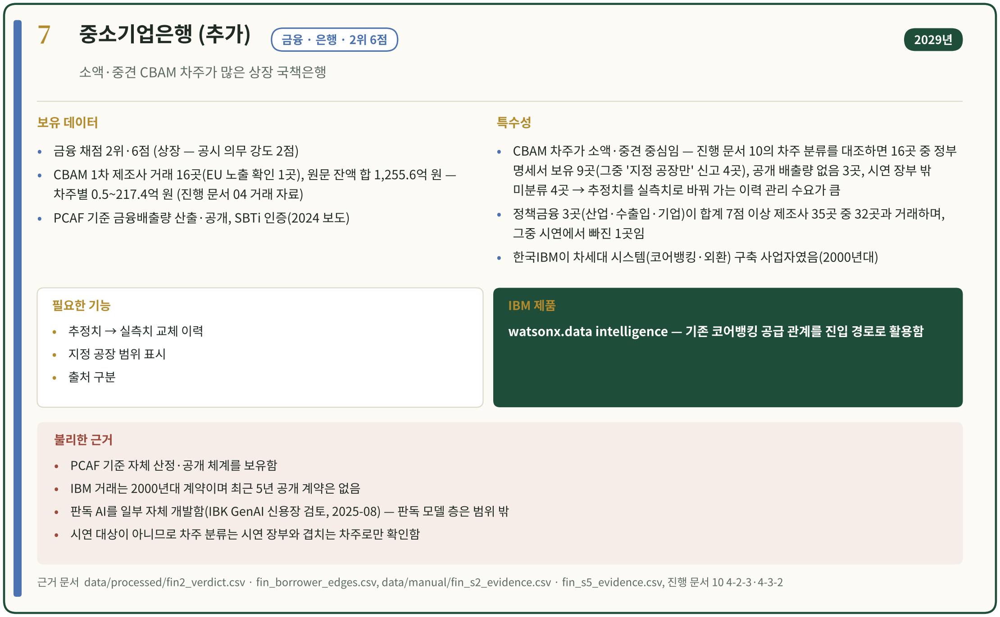

표 원문 보기

| 항목 | 내용 |
|---|---|
| 보유 데이터 | 금융 채점 2위·6점 (상장 — 공시 의무 강도 2점) / CBAM 1차 제조사 거래 16곳(EU 노출 확인 1곳), 원문 잔액 합 1,255.6억 원 — 차주별 0.5\~217.4억 원 (진행 문서 04 거래 자료) / PCAF 기준 금융배출량 산출·공개, SBTi 인증(2024 보도) |
| 특수성 | CBAM 차주가 소액·중견 중심임 — 진행 문서 10의 차주 분류를 대조하면 16곳 중 정부 명세서 보유 9곳(그중 '지정 공장만' 신고 4곳), 공개 배출량 없음 3곳, 시연 장부 밖 미분류 4곳 → 추정치를 실측치로 바꿔 가는 이력 관리 수요가 큼 · 정책금융 3곳(산업·수출입·기업)이 합계 7점 이상 제조사 35곳 중 32곳과 거래하며, 그중 시연에서 빠진 1곳임 · 한국IBM이 차세대 시스템(코어뱅킹·외환) 구축 사업자였음(2000년대) |
| 필요한 기능 | 추정치 → 실측치 교체 이력 · 지정 공장 범위 표시 · 출처 구분 |
| IBM 제품 | watsonx.data intelligence — 기존 코어뱅킹 공급 관계를 진입 경로로 활용함 |
| 불리한 근거 | PCAF 기준 자체 산정·공개 체계를 보유함 · IBM 거래는 2000년대 계약이며 최근 5년 공개 계약은 없음 · 판독 AI를 일부 자체 개발함(IBK GenAI 신용장 검토, 2025-08) — 판독 모델 층은 범위 밖 · 시연 대상이 아니므로 차주 분류는 시연 장부와 겹치는 차주로만 확인함 |
| 근거 문서 | data/processed/fin2_verdict.csv · fin_borrower_edges.csv, data/manual/fin_s2_evidence.csv · fin_s5_evidence.csv, 진행 문서 10 4-2-3·4-3-2 |

<b>8. 한국산업은행 — CBAM 제조사 최다 대출, 장부를 처음 구축하는 국책은행</b>

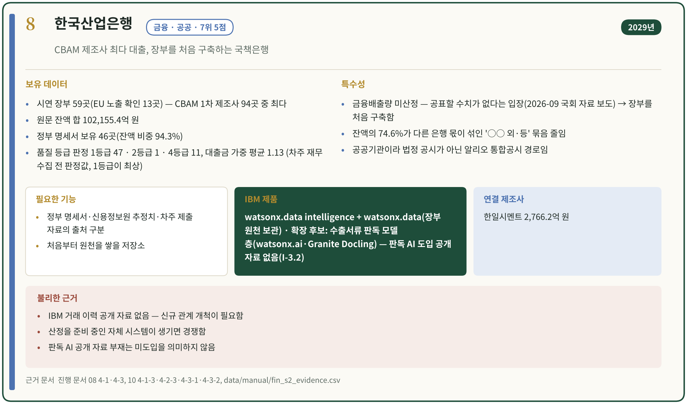

표 원문 보기

| 항목 | 내용 |
|---|---|
| 보유 데이터 | 시연 장부 59곳(EU 노출 확인 13곳) — CBAM 1차 제조사 94곳 중 최다 / 원문 잔액 합 102,155.4억 원 / 정부 명세서 보유 46곳(잔액 비중 94.3%) / 품질 등급 판정 1등급 47 · 2등급 1 · 4등급 11, 대출금 가중 평균 1.13 (차주 재무 수집 전 판정값, 1등급이 최상) |
| 특수성 | 금융배출량 미산정 — 공표할 수치가 없다는 입장(2026-09 국회 자료 보도) → 장부를 처음 구축함 · 잔액의 74.6%가 다른 은행 몫이 섞인 '○○ 외·등' 묶음 줄임 · 공공기관이라 법정 공시가 아닌 알리오 통합공시 경로임 |
| 필요한 기능 | 정부 명세서·신용정보원 추정치·차주 제출 자료의 출처 구분 · 처음부터 원천을 쌓을 저장소 |
| IBM 제품 | watsonx.data intelligence + watsonx.data(장부 원천 보관) · 확장 후보: 수출서류 판독 모델 층(watsonx.ai·Granite Docling) — 판독 AI 도입 공개 자료 없음(Ⅰ-3.2) |
| 연결 제조사 | 한일시멘트 2,766.2억 원 |
| 불리한 근거 | IBM 거래 이력 공개 자료 없음 — 신규 관계 개척이 필요함 · 산정을 준비 중인 자체 시스템이 생기면 경쟁함 · 판독 AI 공개 자료 부재는 미도입을 의미하지 않음 |
| 근거 문서 | 진행 문서 08 4-1·4-3, 10 4-1-3·4-2-3·4-3-1·4-3-2, data/manual/fin_s2_evidence.csv |

<b>9. 한국수출입은행 — 공시값 없이 자체 시스템을 구축 중인 국책은행</b>

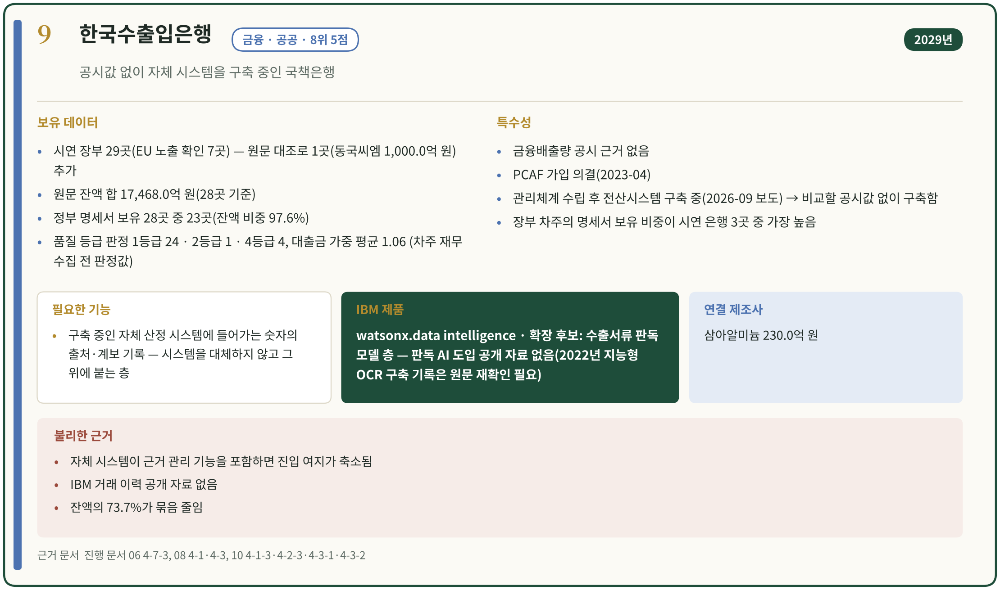

표 원문 보기

| 항목 | 내용 |
|---|---|
| 보유 데이터 | 시연 장부 29곳(EU 노출 확인 7곳) — 원문 대조로 1곳(동국씨엠 1,000.0억 원) 추가 / 원문 잔액 합 17,468.0억 원(28곳 기준) / 정부 명세서 보유 28곳 중 23곳(잔액 비중 97.6%) / 품질 등급 판정 1등급 24 · 2등급 1 · 4등급 4, 대출금 가중 평균 1.06 (차주 재무 수집 전 판정값) |
| 특수성 | 금융배출량 공시 근거 없음 · PCAF 가입 의결(2023-04) · 관리체계 수립 후 전산시스템 구축 중(2026-09 보도) → 비교할 공시값 없이 구축함 · 장부 차주의 명세서 보유 비중이 시연 은행 3곳 중 가장 높음 |
| 필요한 기능 | 구축 중인 자체 산정 시스템에 들어가는 숫자의 출처·계보 기록 — 시스템을 대체하지 않고 그 위에 붙는 층 |
| IBM 제품 | watsonx.data intelligence · 확장 후보: 수출서류 판독 모델 층 — 판독 AI 도입 공개 자료 없음(2022년 지능형 OCR 구축 기록은 원문 재확인 필요) |
| 연결 제조사 | 삼아알미늄 230.0억 원 |
| 불리한 근거 | 자체 시스템이 근거 관리 기능을 포함하면 진입 여지가 축소됨 · IBM 거래 이력 공개 자료 없음 · 잔액의 73.7%가 묶음 줄임 |
| 근거 문서 | 진행 문서 06 4-7-3, 08 4-1·4-3, 10 4-1-3·4-2-3·4-3-1·4-3-2 |

<b>10. 하나은행 — 그룹 공시는 있으나 은행 단독 값이 없는 시중은행</b>

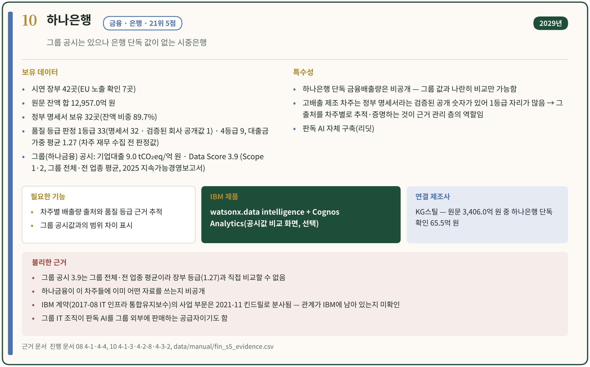

표 원문 보기

| 항목 | 내용 |
|---|---|
| 보유 데이터 | 시연 장부 42곳(EU 노출 확인 7곳) / 원문 잔액 합 12,957.0억 원 / 정부 명세서 보유 32곳(잔액 비중 89.7%) / 품질 등급 판정 1등급 33(명세서 32 · 검증된 회사 공개값 1) · 4등급 9, 대출금 가중 평균 1.27 (차주 재무 수집 전 판정값) / 그룹(하나금융) 공시: 기업대출 9.0 tCO₂eq/억 원 · Data Score 3.9 (Scope 1·2, 그룹 전체·전 업종 평균, 2025 지속가능경영보고서) |
| 특수성 | 하나은행 단독 금융배출량은 비공개 — 그룹 값과 나란히 비교만 가능함 · 고배출 제조 차주는 정부 명세서라는 검증된 공개 숫자가 있어 1등급 자리가 많음 → 그 출처를 차주별로 추적·증명하는 것이 근거 관리 층의 역할임 · 판독 AI 자체 구축(리딧) |
| 필요한 기능 | 차주별 배출량 출처와 품질 등급 근거 추적 · 그룹 공시값과의 범위 차이 표시 |
| IBM 제품 | watsonx.data intelligence + Cognos Analytics(공시값 비교 화면, 선택) |
| 연결 제조사 | KG스틸 — 원문 3,406.0억 원 중 하나은행 단독 확인 65.5억 원 |
| 불리한 근거 | 그룹 공시 3.9는 그룹 전체·전 업종 평균이라 장부 등급(1.27)과 직접 비교할 수 없음 · 하나금융이 이 차주들에 이미 어떤 자료를 쓰는지 비공개 · IBM 계약(2017-08 IT 인프라 통합유지보수)의 사업 부문은 2021-11 킨드릴로 분사됨 — 관계가 IBM에 남아 있는지 미확인 · 그룹 IT 조직이 판독 AI를 그룹 외부에 판매하는 공급자이기도 함 |
| 근거 문서 | 진행 문서 08 4-1·4-4, 10 4-1-3·4-2-8·4-3-2, data/manual/fin_s5_evidence.csv |

### Ⅳ-2.3 10개 기업별 판매 제품 — 요약

- 같은 CBAM 업종이라도 제조사마다 배출 규모, 공정 단계(제강·단조·압연·도금·소성), 등록 공장 수와 공장별 CBAM 해당 여부, 원재료 조달 방식(외부 매입 비중·단일 공급사·원산지 증빙), 공장 간 반제품 이동, 사용 중인 산정 도구가 달라 하나의 산정 틀로 일괄 처리할 수 없음 → 회사별로 수치의 출처와 배분 근거를 관리하는 거버넌스가 필요함
- 순서: 접촉 연도 → 트랙 안 순위

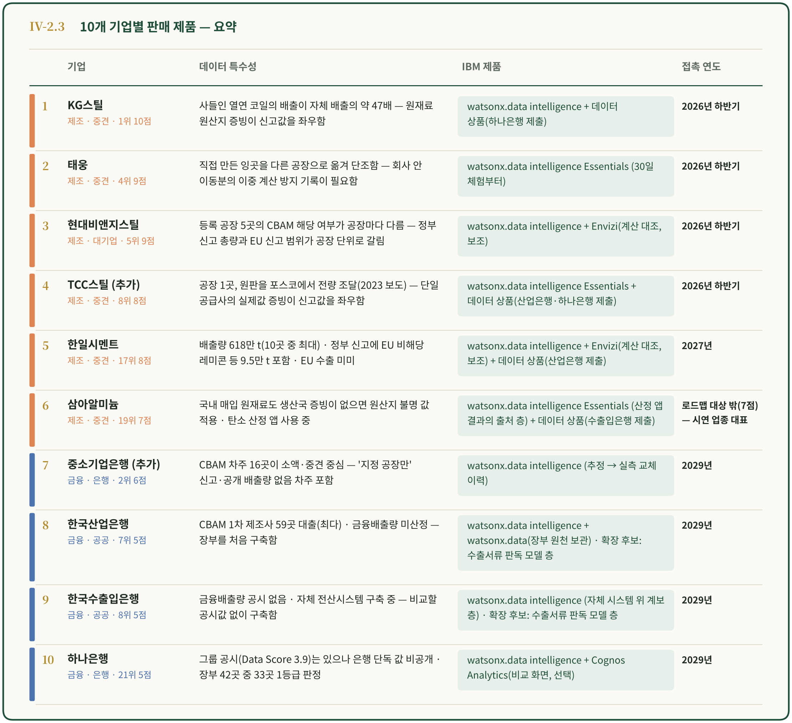

표 원문 보기

| 순서 | 기업 | 구분 | 데이터 특수성 | IBM 제품 | 접촉 연도 |
|---|---|---|---|---|---|
| 1 | KG스틸 | 제조 · 중견 · 1위 10점 | 사들인 열연 코일의 배출이 자체 배출의 약 47배 — 원재료 원산지 증빙이 신고값을 좌우함 | watsonx.data intelligence + 데이터 상품(하나은행 제출) | 2026년 하반기 |
| 2 | 태웅 | 제조 · 중견 · 4위 9점 | 직접 만든 잉곳을 다른 공장으로 옮겨 단조함 — 회사 안 이동분의 이중 계산 방지 기록이 필요함 | watsonx.data intelligence Essentials (30일 체험부터) | 2026년 하반기 |
| 3 | 현대비앤지스틸 | 제조 · 대기업 · 5위 9점 | 등록 공장 5곳의 CBAM 해당 여부가 공장마다 다름 — 정부 신고 총량과 EU 신고 범위가 공장 단위로 갈림 | watsonx.data intelligence + Envizi(계산 대조, 보조) | 2026년 하반기 |
| 4 | TCC스틸 (추가) | 제조 · 중견 · 8위 8점 | 공장 1곳, 원판을 포스코에서 전량 조달(2023 보도) — 단일 공급사의 실제값 증빙이 신고값을 좌우함 | watsonx.data intelligence Essentials + 데이터 상품(산업은행·하나은행 제출) | 2026년 하반기 |
| 5 | 한일시멘트 | 제조 · 중견 · 17위 8점 | 배출량 618만 t(10곳 중 최대) · 정부 신고에 EU 비해당 레미콘 등 9.5만 t 포함 · EU 수출 미미 | watsonx.data intelligence + Envizi(계산 대조, 보조) + 데이터 상품(산업은행 제출) | 2027년 |
| 6 | 삼아알미늄 | 제조 · 중견 · 19위 7점 | 국내 매입 원재료도 생산국 증빙이 없으면 원산지 불명 값 적용 · 탄소 산정 앱 사용 중 | watsonx.data intelligence Essentials (산정 앱 결과의 출처 층) + 데이터 상품(수출입은행 제출) | 로드맵 대상 밖(7점) — 시연 업종 대표 |
| 7 | 중소기업은행 (추가) | 금융 · 은행 · 2위 6점 | CBAM 차주 16곳이 소액·중견 중심 — '지정 공장만' 신고·공개 배출량 없음 차주 포함 | watsonx.data intelligence (추정 → 실측 교체 이력) | 2029년 |
| 8 | 한국산업은행 | 금융 · 공공 · 7위 5점 | CBAM 1차 제조사 59곳 대출(최다) · 금융배출량 미산정 — 장부를 처음 구축함 | watsonx.data intelligence + watsonx.data(장부 원천 보관) · 확장 후보: 수출서류 판독 모델 층 | 2029년 |
| 9 | 한국수출입은행 | 금융 · 공공 · 8위 5점 | 금융배출량 공시 없음 · 자체 전산시스템 구축 중 — 비교할 공시값 없이 구축함 | watsonx.data intelligence (자체 시스템 위 계보 층) · 확장 후보: 수출서류 판독 모델 층 | 2029년 |
| 10 | 하나은행 | 금융 · 은행 · 21위 5점 | 그룹 공시(Data Score 3.9)는 있으나 은행 단독 값 비공개 · 장부 42곳 중 33곳 1등급 판정 | watsonx.data intelligence + Cognos Analytics(비교 화면, 선택) | 2029년 |

- watsonx.data intelligence: 계보·품질·카탈로그·데이터 상품 기능을 갖춘 근거 관리 층 제품이며 10곳 공통 제품임
- 데이터 상품: watsonx.data intelligence 안에서 정리한 데이터 묶음을 이용자가 구독해 받아 가는 기능 — 시연 연결 장면에서 제조사 기록을 대출 은행에 전달하는 데 사용함 (Essentials 요금제 기준 데이터 상품 구독 월 100건)
- 보조 제품(Envizi·watsonx.data·Cognos Analytics)은 장면 구성용이며 판매 제품의 공백 충족 판정 대상이 아님

### Ⅳ-2.4 제품별 정리

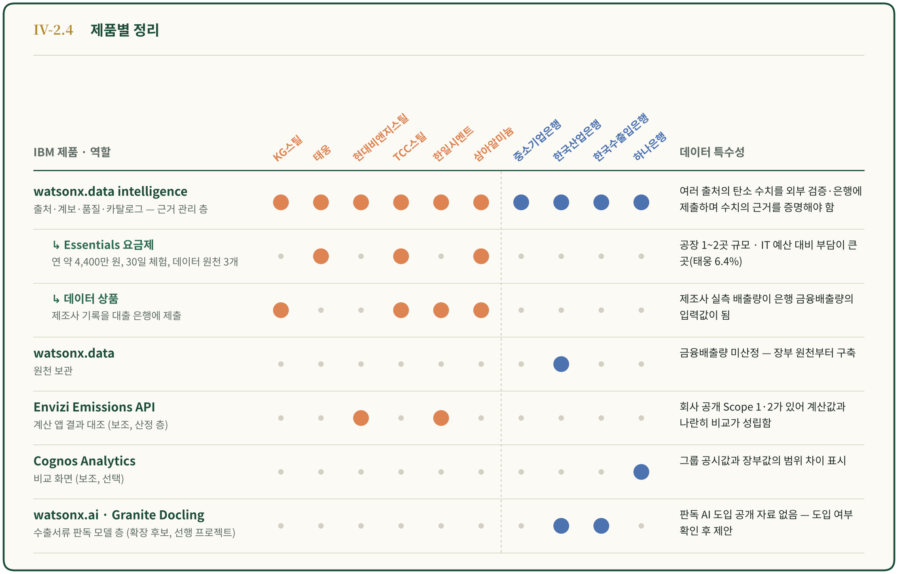

표 원문 보기

| IBM 제품 | 역할 | 해당 기업 | 데이터 특수성 |
|---|---|---|---|
| watsonx.data intelligence | 출처·계보·품질·카탈로그 — 근거 관리 층 | 10곳 전부 | 여러 출처의 탄소 수치를 외부 검증·은행에 제출하며 수치의 근거를 증명해야 함 |
| ↳ Essentials 요금제 | 연 약 4,400만 원, 30일 체험, 데이터 원천 3개 | 태웅 · TCC스틸 · 삼아알미늄 | 공장 1\~2곳 규모 · IT 예산 대비 부담이 큰 곳(태웅 6.4%) |
| ↳ 데이터 상품 | 제조사 기록을 대출 은행에 제출 | KG스틸(→ 하나) · TCC스틸(→ 산업·하나) · 한일시멘트(→ 산업) · 삼아알미늄(→ 수출입) | 제조사 실측 배출량이 은행 금융배출량의 입력값이 됨 |
| watsonx.data | 원천 보관 | 한국산업은행 | 금융배출량 미산정 — 장부 원천부터 구축 |
| Envizi Emissions API | 계산 앱 결과 대조 (보조, 산정 층) | 현대비앤지스틸 · 한일시멘트 | 회사 공개 Scope 1·2가 있어 계산값과 나란히 비교가 성립함 |
| Cognos Analytics | 비교 화면 (보조, 선택) | 하나은행 | 그룹 공시값과 장부값의 범위 차이 표시 |
| watsonx.ai · Granite Docling | 수출서류 판독 모델 층 (확장 후보, 선행 프로젝트) | 한국산업은행 · 한국수출입은행 | 판독 AI 도입 공개 자료 없음 — 도입 여부 확인 후 제안 |

### Ⅳ-2.5 판매 구조와 셀링포인트

- 판매 구조: 도입 → 확장 2단계 — 제조 2026\~2027년 도입·2028년 이후 확장, 금융 2029년 도입·2030년 이후 확장 (Essentials → Standard·Premium)
- 셀링포인트: 책임을 대신 지는 도구가 아니라, 책임을 다했음을 증명하는 기록 — 같은 기록을 ESG 공시 면책 요건(2031년 이후)·제3자 인증(2030년 이후)·데이터 사고 시 관리 체계 입증에 사용함
- 정부 플랫폼과의 관계: 산업통상자원부 공급망 탄소 데이터 스페이스는 연결 대상, 신용정보원 금융배출량 플랫폼은 데이터 출처이며 대체·경쟁 대상이 아님 — 플랫폼이 금융회사별 출처 구분·변경 이력·증빙 관리로 확대를 발표하면 재판정함 (Ⅲ-2.3)

### Ⅳ-2.6 결론

- 10곳 모두에 watsonx.data intelligence를 공통 제품으로 제안함 — 판매 대상인 근거 관리 층의 제품임
- 기업별 차이는 데이터의 특수성에서 나옴
  - 원재료 증빙이 신고값을 좌우하는 곳(KG스틸·TCC스틸·삼아알미늄): 공급사 원산지·실제값 증빙의 계보
  - 공장마다 신고 범위가 갈리는 곳(현대비앤지스틸·한일시멘트·태웅): 공장 단위 범위 구분과 이동 기록
  - 은행(중소기업은행·한국산업은행·한국수출입은행·하나은행): 차주별 배출량의 출처와 품질 등급 근거
- 접촉 순서: 2026년 하반기 KG스틸·태웅·현대비앤지스틸·TCC스틸 → 2027년 한일시멘트 → 2029년 중소기업은행·한국산업은행·한국수출입은행·하나은행
- 두 트랙을 잇는 판매 장면: 제조사가 만든 기록을 데이터 상품으로 대출 은행에 전달함(KG스틸 → 하나은행 등) — 같은 기록이 CBAM 신고·ESG 공시·은행 금융배출량에 함께 쓰임

### Ⅳ-2.7 전체 연결 논리 — 고객 과제를 숫자로 찾고, 그 숫자로 접촉 순서를 정함

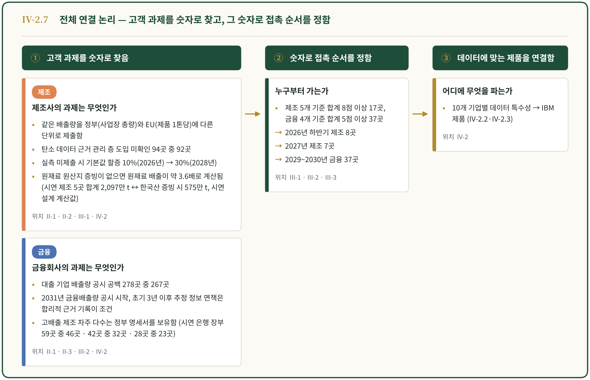

표 원문 보기

| 단계 | 질문 | 숫자 | 위치 |
|---|---|---|---|
| ① 고객 과제 발견 — 제조 | 제조사의 과제는 무엇인가 | 같은 배출량을 정부(사업장 총량)와 EU(제품 1톤당)에 다른 단위로 제출함 · 탄소 데이터 근거 관리 층 도입 미확인 94곳 중 92곳 · 실측 미제출 시 기본값 할증 10%(2026년) → 30%(2028년) · 원재료 원산지 증빙이 없으면 원재료 배출이 약 3.6배로 계산됨 (시연 제조 5곳 합계 2,097만 t ↔ 한국산 증빙 시 575만 t, 시연 설계 계산값) | Ⅱ-1 · Ⅱ-2 · Ⅲ-1 · Ⅳ-2 |
| ① 고객 과제 발견 — 금융 | 금융회사의 과제는 무엇인가 | 대출 기업 배출량 공시 공백 278곳 중 267곳 · 2031년 금융배출량 공시 시작, 초기 3년 이후 추정 정보 면책은 합리적 근거 기록이 조건 · 고배출 제조 차주 다수는 정부 명세서를 보유함 (시연 은행 장부 59곳 중 46곳 · 42곳 중 32곳 · 28곳 중 23곳) | Ⅱ-1 · Ⅱ-3 · Ⅲ-2 · Ⅳ-2 |
| ② 접촉 순서 결정 | 누구부터 가는가 | 제조 5개 기준 합계 8점 이상 17곳, 금융 4개 기준 합계 5점 이상 37곳 → 2026년 하반기 제조 8곳 → 2027년 제조 7곳 → 2029\~2030년 금융 37곳 | Ⅲ-1 · Ⅲ-2 · Ⅲ-3 |
| ③ 제품 연결 | 어디에 무엇을 파는가 | 10개 기업별 데이터 특수성 → IBM 제품 (Ⅳ-2.2·Ⅳ-2.3) | Ⅳ-2 |

- 결론의 무게중심은 데이터 근거임 — 각 판단은 공시·고시·보고서의 숫자를 근거로 하며, 원문까지 추적할 수 있도록 근거 문서를 함께 기재함

### Ⅳ-2.8 결론에 붙는 조건

표 원문 보기

| 조건 | 상태 |
|---|---|
| CBAM 하류 범위 | 미정 — 3자 협상 중, 2028년 후보는 확정 후 재평가 |
| ESG 공시 법률 | 미정 — 정부 최종안 확정, 자본시장법 개정안 국회 계류 |
| 제3자 인증 범위 | 미정 — 2030년 의무화 방침, 범위·수준은 법령 개정 과정에서 확정 |
| 판매 제품의 공백 충족 가능 여부 | IBM 공식 문서 기준 부분 채택 — 실제 형태 데이터 판정은 시연 진행 중 (Ⅳ-1.2) |
| 은행의 검증 가능한 배출 데이터 요구 | 부분 채택 — 요구는 대체가 허용되고 우대는 은행 1곳뿐임. 전환금융 실무 모범규준 확정 후 재판정 |
| 제조사·금융회사의 근거 관리 층 공백 | 공개 자료 범위의 판정 |
| 추가 2곳(TCC스틸·중소기업은행) | 시연 대상이 아니므로 실제 형태 데이터 검증 없음 — 공개 자료 판정만 적용함 |
| 은행 장부 품질 등급 | 차주 재무(회사 가치) 수집 전 판정값임 |
| 시연 계산값 | 월별·공장별 값과 일부 원재료 매입 수량은 합성값임 — 실제 도입 시 회사 기록으로 대체되는 자리임 |
| 금융 제품 구성 | IBM Envizi Financed Emissions 출시 시 재판정함 (2026-10 기준 대기 명단 등록 단계) |
| 확장 후보(판독 모델 층) | 공개 자료 부재 기준이며, 은행별 도입 여부 확인 후 제안함 |
| 회사 간 데이터 전달 | 데이터 상품의 회사 간(제조사 → 은행) 제공 방식과 산업통상자원부 공급망 탄소 데이터 스페이스(EDC 커넥터) 연동은 IBM 공식 자료로 확인하기 전임 |

---

<b>부록 — 진행 문서 표기 대조·추가 그림·조사 원칙·출처</b>

### A. 진행 문서 표기 대조

- 진행 문서(docs/progress)와 상세 보고서(REPORT.md)는 가설과 기준을 기호로 표기함. 본 대조표는 대시보드 명칭과 진행 문서 기호의 대응 관계임

| 본 대시보드 명칭 | 진행 문서 표기 |
|---|---|
| 가설 — 제조사의 탄소 데이터 근거 관리 층 공백 | H1 |
| 가설 — 구매 필요성·구매 여력·진입 여지를 동시에 갖춘 제조사의 존재 | H2 |
| 가설 — 금융회사의 대출 기업 배출량 근거 관리 공백 | H3 |
| 가설 — 판매 제품의 출처·계보 공백 충족 | H4 |
| 가설 — 은행의 검증 가능한 배출 데이터 요구 | H5 |
| 제조 기준: 이중 보고 대조 부담 · 데이터 분산도 · IT 투자 여력 · 거버넌스 경쟁 부재 · EU 노출 | ② · ③ · ④ · ⑤ · ⑥ |
| 금융 기준: 공시 의무 강도 · 금융배출량 공시 공백 · 제조업 대출 노출 · IBM 거래 이력 | ① · ② · ③ · ⑤ |

### B. 추가 그림

### C. 조사 원칙

- 정확: 수치는 원문으로 확인하고, 원인 설명도 원문 확인 후에만 기재함
- 심도: 배경(규제·금융 업종 구조·소유 관계)까지 연계해 조사함
- 완벽: 대상 전체를 동일 기준으로 처리하고, 기준 변경 시 이미 판정한 계정에도 소급 적용함
- 철저: 확인 사실·추정·미확인 사항을 구분 표시하고, 불리한 근거도 유리한 근거와 동일 비중으로 기재함
- 최근 뉴스: 규제 일정·회사 변동은 기준일 직전 자료로 재확인하고, 과거 자료는 연도를 명시함

### D. 근거 등급

| 등급 | 자료 |
|---|---|
| 1 | 공시 원문 — DART 사업보고서·감사보고서, KIND |
| 2 | 정부·감독기관 — 금융위원회·금융감독원·기획재정부·통계청 보도자료 |
| 3 | 신용평가사 — 한국기업평가·한국신용평가·NICE, 무디스·S&P |
| 4 | 회사 공식 — 홈페이지·IR 자료·공식 보도자료 |
| 5 | 주요 언론·글로벌 조사기관 — 조선·중앙·동아·한경·매경, 글로벌 IB·조사기관 리서치 |
| 사용 배제 | 위키백과·나무위키·취업 정보 사이트·블로그 |

### E. 추가 조사 출처 (확인 2026-10-15)

- 문제 정의: [IBM 2025년 4분기 실적 발표 (2026-01-28)](https://newsroom.ibm.com/2026-01-28-IBM-RELEASES-FOURTH-QUARTER-RESULTS) · [IBM 2025 연차보고서](https://www.sec.gov/Archives/edgar/data/51143/000005114326000027/ibmars2025.pdf) · [ICC 은행위원회 기술 자문 브리핑 3호 (2022-06-27)](https://library.iccwbo.org//content//tfb//BRIEFINGS//20220627_TA_Briefing_No3_reducing_discrepancy_rates.pdf) · [UCP 600 원문 (제2조·제14조)](https://eclass-b.uoa.gr/modules/document/file.php/LAW1023/UCP%20600.pdf) · [선행 프로젝트 trade-doc-parsing-model-eval](https://github.com/eugeejo-ui/trade-doc-parsing-model-eval)
- 판매 정책: [IBM watsonx.ai 소프트웨어 변경 내역](https://www.ibm.com/docs/SSLSRPV_latest/fixlist/watsonxai-fixlist.html) · [IBM Granite](https://www.ibm.com/granite) · [Hugging Face granite-docling-258M](https://huggingface.co/ibm-granite/granite-docling-258M) · [리눅스재단 Docling 기증 (2025-04-29)](https://www.linuxfoundation.org/press/ai-workflows-get-new-open-source-tools-to-advance-document-intelligence-data-quality-and-decentralized-ai-with-ibms-contribution-of-3-projects-to-linux-fou-1745937200621) · [가트너 소형 특화 모델 전망 (2025-04-09)](https://www.gartner.com/en/newsroom/press-releases/2025-04-09-gartner-predicts-by-2027-organizations-will-use-small-task-specific-ai-models-three-times-more-than-general-purpose-large-language-models) · [맥킨지 Open source technology in the age of AI (2025-04-22)](https://www.mckinsey.com/capabilities/quantumblack/our-insights/open-source-technology-in-the-age-of-ai)
- 망분리: [신&김 뉴스레터 (2026-05-08)](https://shinkim.com/kor/media/newsletter/3267) · [헤럴드경제 (2026-04-19)](https://www.heraldk.com/article/2026041913000050844) · [디지털데일리 (2026-07-15)](https://www.ddaily.co.kr/page/view/2026071517443276094)
- 은행 판독 AI: [KB Think (2023-06-13)](https://kbthink.com/main/economy/economic-in-depth-analysis/economic-research-report/series5-230613.html) · [조세금융신문 KB AI-OCR 부수업무 (2024-07-24)](https://tfmedia.co.kr/news/article.html?no=166723) · [세계타임즈 하나은행 리딧 (2024-06-24)](https://m.thesegye.com/news/view/1065575925565842) · [헤럴드경제 하나은행 수출서류작성 가이드 (2026-03-25)](https://www.heraldk.com/article/2026032516171238943) · [바이라인네트워크 IBK GenAI (2026-07-29)](https://byline.network/2026/07/0729-2/) · [데일리안 신한은행 클로바 OCR (2020-12-15)](https://m.dailian.co.kr/news/view/946615) · [신한금융 수출환어음 매입 AI 심사 (2025-12-11)](https://shinhangroup.com/kr/archive/press/detail/538) · [뉴데일리 우리은행 AI 에이전트 (2026-06-12)](https://biz.newdaily.co.kr/site/data/html/2026/06/12/2026061200073.html) · [SC그룹·IBM Trade AI Engine (2019-05-22)](https://www.sc.com/EN/press-release/weve-pioneered-trade-ai-engine-with-ibm/) · [Business Wire 씨티·Traydstream (2023-12-04)](https://www.businesswire.com/news/home/20231204508925/en/Citi-Collaborates-With-Traydstream-to-Streamline-Document-Services-for-Faster-and-More-Effective-Client-Solutions) · [MTN 2027년도 시스템적 중요 은행 지정 (2026-07-31)](https://news.mtn.co.kr/news-detail/2026073116305530726)
- 비은행 문서 AI: [재경일보 삼성생명 (2023-10-24)](https://news.jkn.co.kr/post/842762) · [더팩트 한화생명 (2023-02-01)](https://news.tf.co.kr/read/ogmeta/1995959.htm) · [이코노미스트 로민 (2024-01-15)](https://economist.co.kr/article/view/ecn202311210032) · [헤럴드경제 삼성화재 (2025-08-20)](https://www.heraldk.com/article/2025082015452003017) · [재경일보 메리츠화재–KT (2025-11-06)](https://news.jkn.co.kr/post/855268) · [데일리안 하나금융 리딧 (2025-08-25)](https://www.dailian.co.kr/news/view/1539777) · [벤처스퀘어 KB국민카드 (2024-10-21)](https://www.venturesquare.net/943684/) · [아이뉴스24 미래에셋증권 (2022-07-26)](https://www.inews24.com/view/1504189)
- 통계: [산업일보 금감원 AI 실태조사 (2026-01-17)](https://kidd.co.kr/news/244669) · [헤럴드경제 핀테크산업협회 포럼 (2026-06-23)](https://www.heraldk.com/article/2026062318143379488) · [케임브리지 대안금융센터 2026 보고서](https://jbs.cam.ac.uk/faculty-research/centres/alternative-finance/publications/2026-global-ai-in-financial-services-report) · [FSB AI 보고서 (2024-11-14)](https://www.fsb.org/uploads/P14112024.pdf)
- 판매 제품: [IBM 뉴스룸 단독 판매 (2025-06-04)](https://newsroom.ibm.com/blog-ibm-simplifies-the-enterprise-data-stack-for-gen-ai-era) · [AWS 마켓플레이스 SaaS](https://aws.amazon.com/marketplace/pp/prodview-l3fj6yu5ubsnk) · [AWS 마켓플레이스 설치형](https://aws.amazon.com/marketplace/pp/prodview-4lt7554c34ecs) · [디지털데일리 IBM 국내 총판 (2026-04-06)](https://www.ddaily.co.kr/page/view/2026040611040522713)
- 금융 규제·IBM 금융 관계: [뉴시스 ESG 공시 정부 최종안 (2026-07-08)](https://mobile.newsis.com/view/NISX20260708_0003700237) · [EBN 기후금융 활성화 TF (2026-09-14)](https://www.ebn.co.kr/news/articleView.html?idxno=1724103) · [IFRS S2 개정 요약 (2025-12)](https://www.ifrs.org/content/dam/ifrs/supporting-implementation/ifrs-s2/s2-targeted-amendments-at-a-glance.pdf) · [IBM Think What is a mainframe? (2026-09-03)](https://www.ibm.com/think/topics/mainframe) · [바이라인네트워크 메리츠증권 파워11 (2026-03-04)](https://byline.network/2026/03/4-419/) · [Mayer Brown CBAM 하류 확대 3자 협상 (2026-10-07)](https://www.mayerbrown.com/en/insights/publications/2026/10/eus-cbam-downstream-extension-and-anti-circumvention-amendments-the-road-to-trilogue)
- Ⅳ-2 추가 출처: [IB토마토 TCC스틸 원료 수급 (2023-07-20)](https://newstomato.com/ReadNews.aspx?no=1194756) · 기업별 수치는 진행 문서 08·09·10과 레포 data 폴더 파일(각 기업 근거 문서 칸)
- 기존 조사의 전체 출처: [REPORT.md 참고 문헌](REPORT.md)

